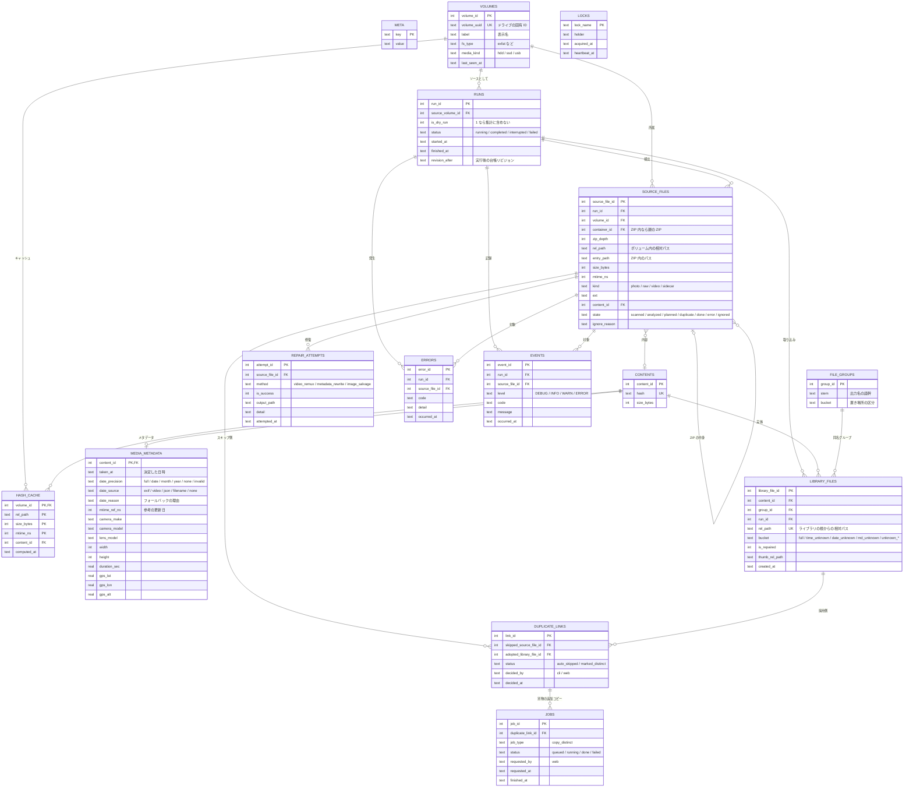

# ER 図(台帳のデータ構造)

台帳(カタログ)は SQLite の 1 ファイルで、**ライブラリごとに 1 つ**(`specification.md` §8)。
CLI・Web・閲覧専用ビューアは、同じ台帳を共有する。閲覧専用ビューアは、スナップショットを読み取り専用で開く。

状態の凡例: **確定** = 設計方針が合意済み / **仮** = 暫定(`features/` と技術選定のあとで見直す)。
列の型は論理的なもの。実際の型は、技術選定のあとで決める。

## 1. 全体図

## 2. テーブルの説明

| テーブル          | 役割                                                                                  | 対応する要件         |
| :---------------- | :------------------------------------------------------------------------------------ | :------------------- |
| `meta`            | スキーマ版、ライブラリ ID、台帳のリビジョン番号を持つ(§8-2)                           | M-05, M-08           |
| `volumes`         | ソースの外付け・内蔵ストレージ。名前ではなく、固有 ID で識別する                      | V-02                 |
| `runs`            | 実行ごとの記録。dry-run は `is_dry_run = 1` で区別する                                | M-03, X-03           |
| `source_files`    | 実行ごとに検出したソース側のファイル。ZIP の中身は、親の ZIP を `container_id` で指す | T-03, T-04           |
| `contents`        | ハッシュで識別する「内容」。同じハッシュは 1 行だけ                                   | P-01                 |
| `hash_cache`      | ハッシュのキャッシュ。キーは(ボリューム, 相対パス, サイズ, mtime)                     | H-02, H-03           |
| `media_metadata`  | 内容ごとの、撮影日時・日付の精度・カメラ・GPS など                                    | I-02, D-_, G-_, S-\* |
| `file_groups`     | RAW+JPEG などの同名グループ。出力名の語幹を共有する                                   | I-05                 |
| `library_files`   | ライブラリに保存したファイル。台帳のパスはすべて相対パス                              | M-06                 |
| `duplicate_links` | 重複の「スキップ側」と「採用側」の対応。Web の「別物」判定の状態もここに持つ          | P-02〜P-05           |
| `repair_attempts` | 修復の試行の記録(手順・成否・出力先)                                                  | R-02〜R-04           |
| `errors`          | エラー一覧の元になる記録                                                              | L-04                 |
| `events`          | 逐次ログの元になるイベント。CLI の表示も Web の実行状況も、ここから作る               | L-01, L-03           |
| `jobs`            | Web から依頼した追加コピーのジョブ(CLI の完了待ちを含む)                              | P-06                 |
| `locks`           | ライブラリへの書き込みの排他制御(§12)                                                 |                      |

## 3. 設計のポイント

### 3-1. 「内容」と「ファイル」を分ける(確定)

- 内容は `contents`(ハッシュで一意)、ファイルは `source_files` と `library_files`。
- 同じ内容が、複数のソースや複数の実行に現れても、メタデータは 1 回だけ取得して持てばよい。
- 重複は、「同じ `content_id` を持つ `source_files` のうち、採用されなかったもの」として表せる。

### 3-2. 日付フォールバックは、専用テーブルを持たない(確定)

- `media_metadata.date_source` が `exif` / `video` 以外のものが、フォールバック。
- 取得元の種別での絞り込み [D-05] は、`date_source` の条件で行う。
- 日付の精度での絞り込み [A-02] は、`date_precision` の条件で行う。
- `date_reason` に、取得できなかった理由を持たせる。

### 3-3. dry-run の扱い(確定)

- dry-run も `runs` と `source_files` に記録する(`runs.is_dry_run = 1`)。
- 通常の集計(アルバム・地図・統計・重複)は、`is_dry_run = 0` の実行だけを対象にする。
- dry-run では `library_files` は作らない。

### 3-4. パスの持ち方(確定)

- ソース側: (`volume_id`, `rel_path`)。マウント先の絶対パスは持たない。
- ライブラリ側: ライブラリの根からの相対パス。
- ZIP の中身: 親の `source_files`(`container_id`)と、ZIP 内のパス(`entry_path`)で表す。
- これにより、ドライブ文字やマウント先が変わっても、台帳をそのまま使える [W-04]。

### 3-5. 重複と「別物」判定の状態(仮)

| `duplicate_links.status` | 意味                                               |
| :----------------------- | :------------------------------------------------- |
| `auto_skipped`           | ハッシュ一致で、自動でスキップした                 |
| `marked_distinct`        | Web で「別物」と判定した。追加コピーのジョブを作る |

- 追加コピーが完了したら、スキップ側の `source_files.state` を `done` にし、新しい `library_files` を作る。
- 同じ組み合わせが、再び重複として表示されないようにするため、`marked_distinct` の記録を残す。

## 4. 値の一覧

### 4-1. `source_files.state`

`scanned` → `analyzed` → `planned` → `done` の流れ。分岐は、`duplicate`(重複でスキップ)、`error`(エラー)、`ignored`(対象外)。
状態遷移は `specification.md` §4-3 に従う。

### 4-2. `library_files.bucket`(置き場所の区分)

| 値                        | 置き場所                     |
| :------------------------ | :--------------------------- |
| `full`                    | `YYYY/MM/`                   |
| `time_unknown`            | `YYYY/MM/_時刻不明/`         |
| `date_unknown`            | `YYYY/MM/_日付不明/`         |
| `md_unknown`              | `YYYY/_月日不明/`            |
| `unknown_none`            | `_unknown/日付なし/`         |
| `unknown_invalid`         | `_unknown/日付が不正/`       |
| `unknown_repaired_nodate` | `_unknown/修復後も日付なし/` |
| `unknown_unreadable`      | `_unknown/読み取り不可/`     |

### 4-3. `errors.code`

`specification.md` §14 のエラー分類に従う。

## 5. インデックス(仮)

| テーブル         | 列                                                  | 用途                                       |
| :--------------- | :-------------------------------------------------- | :----------------------------------------- |
| `contents`       | `hash`(ユニーク)                                    | 重複判定                                   |
| `hash_cache`     | (`volume_id`, `rel_path`, `size_bytes`, `mtime_ns`) | キャッシュの検索                           |
| `library_files`  | `rel_path`(ユニーク)                                | 衝突判定                                   |
| `media_metadata` | `taken_at`、`date_precision`、`date_source`         | アルバム・統計・フォールバック一覧         |
| `media_metadata` | `gps_lat`, `gps_lon`                                | 地図                                       |
| `source_files`   | (`run_id`, `state`)                                 | 実行ごとの一覧                             |
| `events`         | (`run_id`, `event_id`)                              | 逐次ログの読み出し(Web のリアルタイム表示) |

## 6. 運用上の注意

- 台帳は、書き込みを並行しても壊れない設定(WAL など)で使う。具体的な設定は技術選定のあとで決める。
- 書き込みはまとめてコミットする(`specification.md` §17-6)。
- スナップショットは、ライブラリの `.file-seiri/` に保存する。閲覧専用ビューアは、これを読み取り専用で開く。
- 台帳に個人情報(パス・GPS・撮影日時)が入るため、git にコミットしてはならない(`specification.md` §8-1)。
