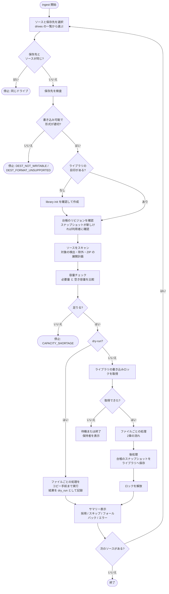
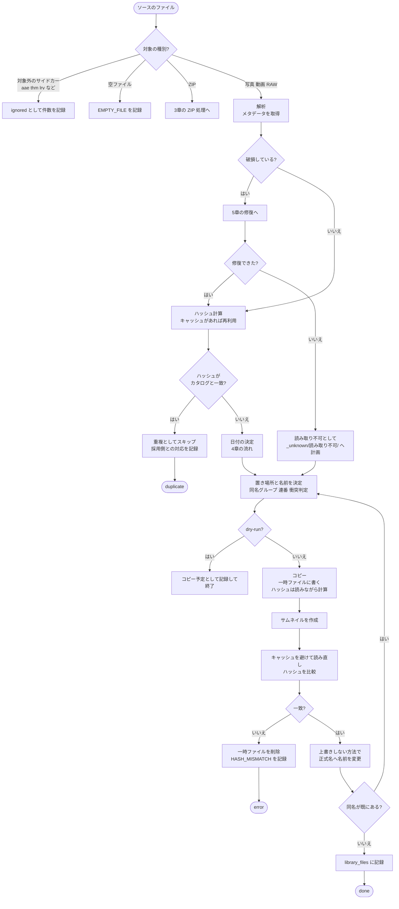
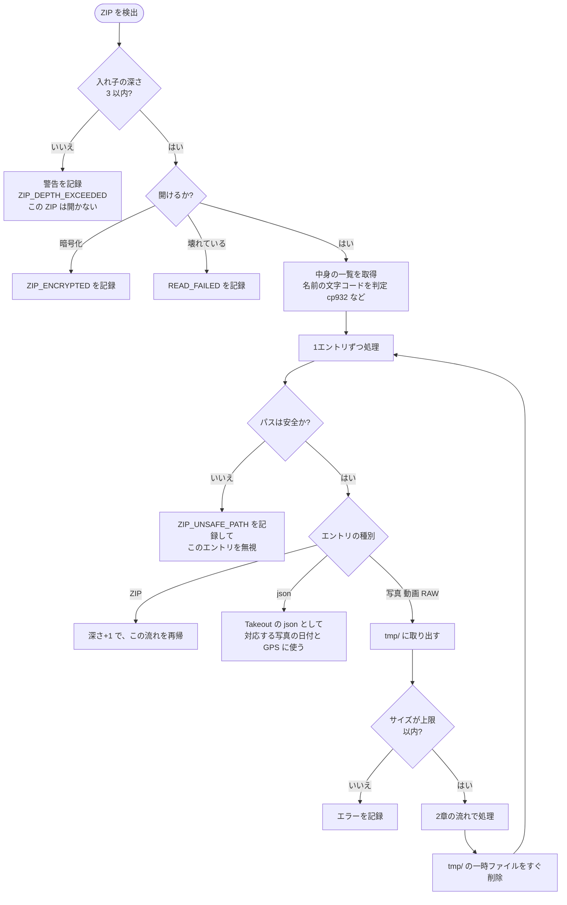
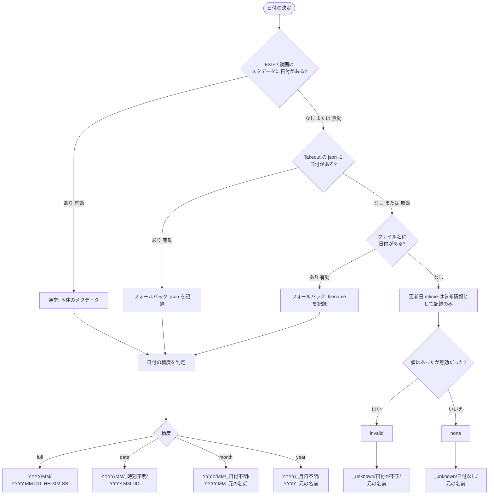
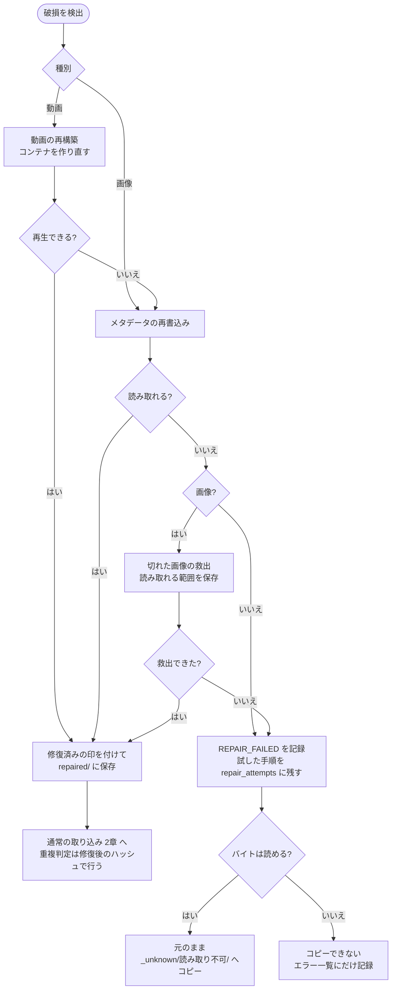
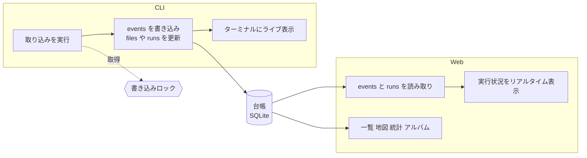
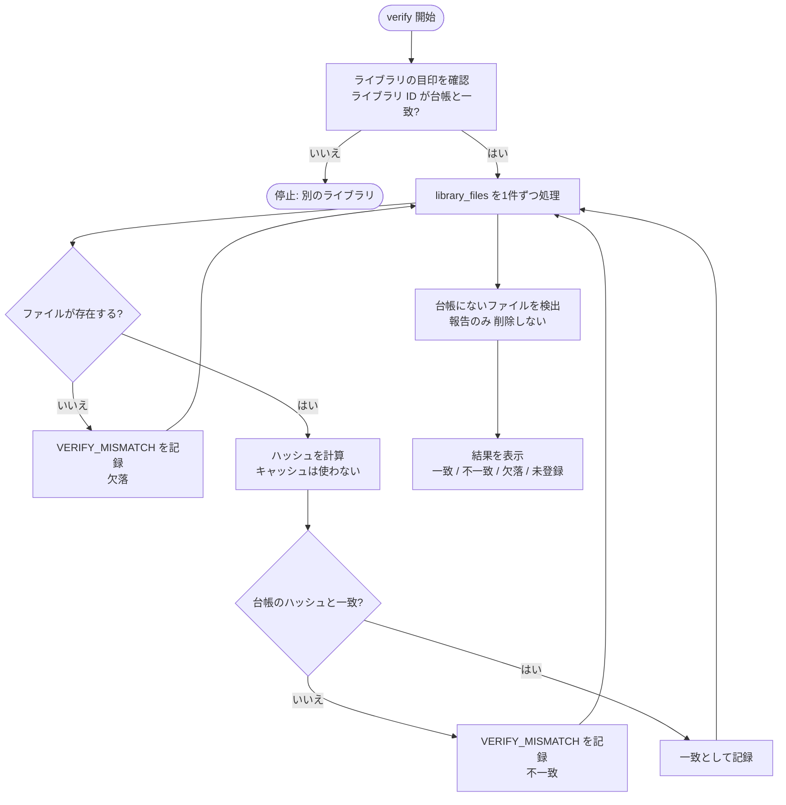

# 処理フロー

仕様書(`docs/specification.md`)の規則を、処理の流れとして図にする。
状態の凡例: **確定** = 合意済みの規則に基づく / **仮** = 仕様書の「仮」に基づく。

## 1. 取り込み全体の流れ(CLI)

仕様書 §4-1, §9, §11 に対応する。

- ソースが複数ある場合は、1つずつ順番に処理する [V-06]。
- dry-run でも、容量チェックの結果を表示する [X-02]。

## 2. 1ファイルあたりの処理

仕様書 §4-2, §5, §7 に対応する。

- 同名が直前に作られていた場合は、連番を取り直して、再度コピーする(仕様書 §7-3)。
- 「読み取り不可」のうち、バイト自体が読めないものは、コピーできないので `COPY_FAILED` または `READ_FAILED` をエラー一覧にだけ記録する(仕様書 §10-3)。

## 3. ZIP の処理

仕様書 §10-1 に対応する。ZIP は、ZIP 全体を展開せず、中の1ファイルずつを取り出して処理する。

- 元の場所の記録は `ソース/path/a.zip!/inner/b.jpg` の形にする。
- Takeout の json は、写真と同じフォルダにある対応ファイルとして、先に読んでおく。

## 4. 日付の決定と置き場所

仕様書 §2-2, §3 に対応する。

- 修復後も日付が取れなかったものは、`_unknown/修復後も日付なし/` に置く(5章)。
- 同名グループでは、グループ内で最も精度の高い取得元で、1回だけ決める(仕様書 §2-3)。
- 日付は、一部が欠けている場合、有効な範囲までを採用する。

## 5. 破損の検出と修復

仕様書 §10-2, §10-3 に対応する。修復は、元ファイルを変更せず、`repaired/` に別ファイルとして作る。

- 各手順の成否は、すべて `repair_attempts` に残す。
- 修復で直った場合でも、日付が取れなければ `_unknown/修復後も日付なし/` に置く。

## 6. CLI と Web の同期

仕様書 §12, §13 に対応する。CLI と Web は同じ台帳を共有する。書き込むのは CLI だけで、Web は読み取り専用。2つの実行が同時に書き込まないよう、ロックで避ける。

- Web の読み取りは、ロックと無関係に常にできる。
- Web は、すべてのモードで読み取り専用で、ロックを取らない。他の PC では、スナップショットを開く。

## 7. ライブラリの照合(verify)

仕様書 §6, §8-4 に対応する。

- ライブラリを別のドライブへコピーしたあとの確認に使う。
- 検出した差異は、エラー一覧に記録する。ファイルの修復や削除はしない。

## 8. 未決

- 各図の「仮」の規則は、`features/` で詳細を確認する。
- 並列処理の具体的な構成(ファイル単位か、ドライブ単位か)は、技術選定のあとで決める(仕様書 §17)。
