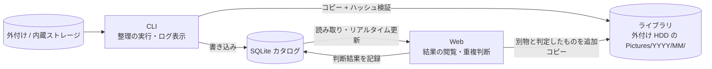

# file-seiri 概要

## 1. 何を作るか

内部ストレージや外付けストレージ(SSD / HDD / USBメモリ)に散らばった写真・動画・RAW ファイルを、
撮影日時をもとに、外付け HDD 上の「ライブラリ」(`Pictures/YYYY/MM/`)へ整理して集約するローカル完結のツール。
整理の過程で取得したメタデータ(GPS・カメラ・撮影時刻など)は SQLite のカタログに蓄積し、
地図・統計・重複確認などを Web 画面で閲覧できる。

- 完全ローカルで動作する(取り込み処理・データ保管・Web 画面とも、外部サービスへデータを送らない)
- 整理は **コピー専用**。元データは触らず、バックアップとして残す
- 単発の大掃除(2TB 前後、1万枚以上)が主用途。継続利用は将来の余地として残す

## 2. 全体像

役割を「整理の初動(CLI)」と「結果の閲覧・追加操作(Web)」で分ける。

| 役割                 | 担当    | 主な内容                                                                                         |
| :------------------- | :------ | :----------------------------------------------------------------------------------------------- |
| 整理の初動           | **CLI** | スキャン、メタデータ取得、ZIP 展開、修復、ハッシュ計算、コピー、dry-run、ログの逐次表示          |
| 結果の閲覧と追加操作 | **Web** | 地図、統計、重複比較、日付フォールバック一覧、エラー一覧、実行状況、「別物」判定とその追加コピー |

CLI と Web は同じ SQLite カタログを共有する。CLI が書き込んだ内容は、実行中でも Web にリアルタイムで反映される。

## 3. 主な機能(一覧)

詳細は `docs/features/` で個別に定義する。

1. 取り込み(スキャン、メタデータ取得、日付によるリネーム、年月フォルダへのコピー)
2. ハッシュ計算・検証・キャッシュ(転送中の破損検知)
3. 重複検出(完全一致のみ。自動スキップして記録)
4. 日付フォールバック(撮影日が取れない場合の代替と、その一覧)
5. ZIP 内ファイルの取り込み
6. 破損ファイルの検出と自動修復の試行
7. dry-run(ファイル操作をせず、結果だけを出す)
8. 複数ソース対応とライブラリ(外付けごとの実行を累積し、上書きで失われない。ライブラリ丸ごとの移行に対応)
9. 地図表示(GPS をピン表示、近いものはクラスタ化、背景地図あり)
10. 統計(月別 / 年別の切替、カメラ別内訳、撮影時間帯分布)
11. 重複比較と「別物」判定(Web)
12. エラー一覧
13. 逐次ログと進捗表示(CLI のライブ表示 / Web の実行状況)
14. ドライブの選択と容量チェック
15. アルバム(Web でのタイムライン閲覧、サムネイル)
16. 閲覧専用ビューア(家の PC 向け。OS ごとの単体の実行ファイル)

## 4. ドキュメント構成

| ファイル                 | 内容                                           |
| :----------------------- | :--------------------------------------------- |
| `docs/overview.md`       | 本書                                           |
| `docs/requirements.md`   | 要件定義                                       |
| `docs/specification.md`  | 仕様書(命名規則、日付優先順位、ライブラリなど) |
| `docs/features/*.md`     | 機能別ドキュメント ※予定                       |
| `docs/er.md`             | ER 図(Mermaid) ※予定                           |
| `docs/flows.md`          | 処理フロー(Mermaid) ※予定                      |
| `docs/tech-selection.md` | 技術選定(要件確定後に実施) ※予定               |
| `docs/rules/`            | 開発ルール                                     |
