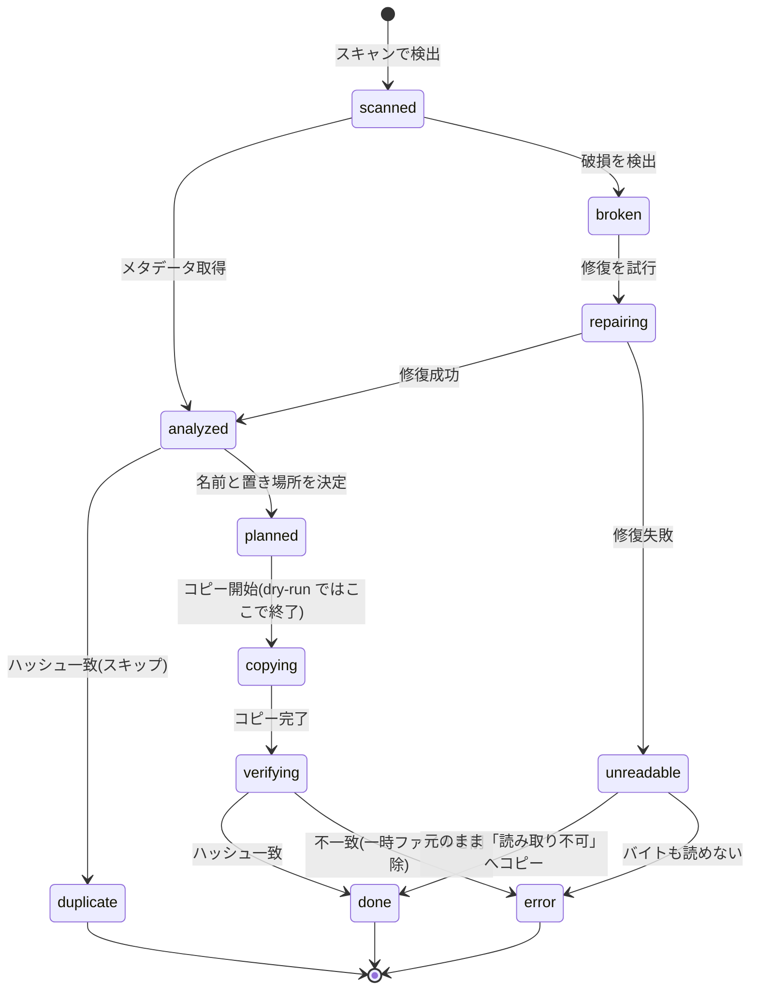

# 仕様書

要件(`docs/requirements.md`)を実現するための具体的な規則を定義する。
状態の凡例: **確定** = 合意済み / **仮** = 暫定案(`features/` の作成時に確認)。要件 ID は `[I-03]` のように併記する。

## 1. 対応ファイル

### 1-1. 拡張子(仮)

判定は拡張子の大文字小文字を区別しない。出力時の拡張子は **小文字に統一**する。

| 種別                      | 拡張子                                                             |
| :------------------------ | :----------------------------------------------------------------- |
| 写真                      | jpg, jpeg, png, heic, heif, tif, tiff, gif, webp                   |
| RAW                       | cr2, cr3, nef, arw, dng, raf, orf, rw2, pef, srw, raw              |
| 動画                      | mp4, mov, m4v, avi, mts, m2ts, mkv, 3gp, wmv, m2t, webm, mpg, mpeg |
| サイドカー(読む / コピー) | `.xmp`(RAW と同名のものをコピー)、Takeout の `.json`(読むだけ)     |
| 対象外(件数のみ記録)      | `.aae`, `.thm`, `.lrv` などの上記以外のサイドカー                  |

拡張子は設定で追加できるようにする。拡張子が対象でも、中身が壊れていれば「破損」として扱う(§10)。

### 1-2. スキャン時に除外するもの

- ドライブの管理用ファイル・フォルダ: `._*`、`.DS_Store`、`.Trashes`、`.Spotlight-V100`、`.fseventsd`、`$RECYCLE.BIN`、`System Volume Information`
- ライブラリの根(出力先)と、作業用の `data/`。出力先を再スキャンして二重に取り込まないため
- macOS の写真アプリのライブラリ(`*.photoslibrary`)。中身が管理用の構造で、ソースとして取り込む対象ではないため(仮)
- サイズが 0 バイトのファイル(エラー一覧に「空ファイル」として記録)

## 2. ライブラリと出力先

### 2-1. ライブラリの構成 [C-05, M-05, M-06]

```text
<保存先ドライブ>/                       ← exFAT など(C-09)
├── Pictures/                          ← ライブラリの根
│   ├── .file-seiri-library.json       ← 目印(ライブラリ ID、作成日、スキーマ版)
│   ├── 2024/
│   │   ├── 05/
│   │   │   ├── _時刻不明/             ← 年月日のみ取れたもの
│   │   │   │   └── 2024.05.01.jpg
│   │   │   ├── _日付不明/             ← 年月のみ取れたもの
│   │   │   │   └── 2024.05_IMG_0002.jpg
│   │   │   ├── 2024.05.01_12-30-45.jpg
│   │   │   ├── 2024.05.01_12-30-45.cr3   ← RAW+JPEG は同名で並べる
│   │   │   ├── 2024.05.01_12-30-45.xmp
│   │   │   └── 2024.05.01_12-30-46_01.mp4
│   │   └── _月日不明/                 ← 年のみ取れたもの
│   │       └── 2024_IMG_0003.jpg
│   ├── _unknown/
│   │   ├── 日付なし/
│   │   ├── 日付が不正/
│   │   ├── 修復後も日付なし/
│   │   └── 読み取り不可/
│   └── .file-seiri/
│       ├── catalog.snapshot.sqlite    ← 台帳のコピー(§8)
│       └── thumbs/                    ← サムネイル(§16)
└── viewer/                            ← 閲覧用プログラム(OS ごと。§16-4)
```

- 写真・動画・RAW は、同じ階層に混在させる [T-06]。
- フォルダ名の先頭の `_` は、並び順で先頭に来るようにするため。
- ファイル名・フォルダ名は、**Unicode の NFC 形式**で保存する。(仮: macOS と Windows の間で、同じ名前が別物として扱われるのを避けるため)

### 2-2. ファイル名と置き場所 [I-03, I-07, U-01〜U-08]

日付の精度(§3-3)によって、置き場所と名前が決まる。

| 日付の精度           | 置き場所(ライブラリの根から) | ファイル名                     |
| :------------------- | :--------------------------- | :----------------------------- |
| 年月日+時刻          | `YYYY/MM/`                   | `YYYY.MM.DD_HH-MM-SS.<拡張子>` |
| 年月日のみ           | `YYYY/MM/_時刻不明/`         | `YYYY.MM.DD.<拡張子>`          |
| 年月のみ             | `YYYY/MM/_日付不明/`         | `YYYY.MM_<元の名前>.<拡張子>`  |
| 年のみ               | `YYYY/_月日不明/`            | `YYYY_<元の名前>.<拡張子>`     |
| 日付なし             | `_unknown/日付なし/`         | `<元の名前>.<拡張子>`          |
| 日付が不正           | `_unknown/日付が不正/`       | `<元の名前>.<拡張子>`          |
| 修復後も日付なし     | `_unknown/修復後も日付なし/` | `<元の名前>.<拡張子>`          |
| 読み取り・修復が不可 | `_unknown/読み取り不可/`     | `<元の名前>.<拡張子>`          |

- 「元の名前」は、拡張子を除いたファイル名。ZIP 内のものは、ZIP 内でのファイル名。
- 連番: 衝突がなければ付けない。衝突したら `_01`、`_02` … を付ける(2桁、100 以上は `_100` と桁を増やす)[I-04]。
  - 例: `2024.05.01.jpg` が既にあれば、`2024.05.01_01.jpg`。
- 日時はローカル時刻(§3-2)。ミリ秒は名前に含めない。

### 2-3. 同名グループ [I-05]

同じソースフォルダにある、元の名前の語幹(拡張子を除いた部分)が同じファイルは **1つのグループ**として扱い、出力名の語幹(日時+連番)と置き場所を共有する。

- 例: `IMG_0001.CR3` / `IMG_0001.JPG` / `IMG_0001.xmp` → 全員 `2024.05.01_12-30-45` + 各拡張子
- iPhone のライブフォト(`IMG_0001.HEIC` + `IMG_0001.MOV`)も同じ扱いとする(確定)
- 実データで見つかった `IMG_1234-video-paired.mov` のように、語幹に決まった接尾辞(既定: `-video-paired`)が付いた動画は、接尾辞を除いた語幹(`IMG_1234`)のグループに入れる。接尾辞の一覧は、設定で追加できる。(仮)
- グループの語幹の比較は、大文字小文字を区別しない(`IMG_1234.JPG` と `img_1234.jpg` は同じ)。
- 日時の決定はグループ内の最も精度の高い取得元で1回だけ行う(例: RAW の EXIF を使い、JPG にも同じ日時を当てる)
- 連番は「グループの全ての拡張子が空いている最初の語幹」を選ぶ。1つでも埋まっていれば次の連番に進む

### 2-4. 衝突判定

次のいずれかに同じ名前があれば衝突とする。

1. 出力先のフォルダに実在するファイル
2. 今回の実行で既に予約済みの名前(並列処理中の取り合いを防ぐため)

衝突時、内容が同じ(ハッシュ一致)なら重複としてスキップし、違えば連番で追加コピーする(§5)。

## 3. 日付の決定 [D-01〜D-05]

### 3-1. 優先順位(確定)

| 優先 | 取得元                                                                                                                                      | 区分                                                   |
| :--- | :------------------------------------------------------------------------------------------------------------------------------------------ | :----------------------------------------------------- |
| 1    | EXIF の DateTimeOriginal(写真・RAW)                                                                                                         | 通常                                                   |
| 2    | 動画の CreateDate(UTC をローカル時刻へ変換)                                                                                                 | 通常                                                   |
| 3    | Takeout の `.json` の撮影日時                                                                                                               | フォールバック(`json`)                                 |
| 4    | ファイル名に含まれる日付(`IMG_20240501_123456`、`20240501`、`2024-05`、13 桁のエポックミリ秒など。詳細は `features/date-resolution.md` 4章) | フォールバック(`filename`)                             |
| —    | ファイルの更新日(mtime)                                                                                                                     | **日付として採用しない**。参考情報として DB に記録する |

- 優先順位1・2で取れなかった時点で「日付フォールバック」とし、取得元の種別と理由を記録する [D-03]。
- 優先順位1の中で DateTimeOriginal がなければ、DateTimeDigitized、CreateDate の順で試す(いずれも本体のメタデータなので通常扱い)。(仮)
- 1〜4のどれでも日付が取れなかった場合(mtime しかない場合を含む)は「日付なし」とする [D-02]。

### 3-2. タイムゾーン(仮)

- 写真: EXIF にオフセット(OffsetTimeOriginal)があれば、その撮影地の時刻をそのまま使う。なければ書かれている値を、そのままローカル時刻として扱う。
- 動画: UTC で記録されていることが多いので、**本機のタイムゾーンへ変換**する。
- 全ての日時を、決定した値と、決定に使った取得元の種別とあわせて記録する。

### 3-3. 日付の精度

取得した値から、次の精度を判定する。

| 精度      | 条件                                                                         |
| :-------- | :--------------------------------------------------------------------------- |
| `full`    | 年・月・日・時刻がすべて有効                                                 |
| `date`    | 年・月・日が有効で、時刻がない                                               |
| `month`   | 年・月だけ有効                                                               |
| `year`    | 年だけ有効                                                                   |
| `none`    | どの取得元からも取れない                                                     |
| `invalid` | 値はあるが無効(`0000:00:00 00:00:00`、13月、1970 年より前、実行時点より未来) |

- 日付の一部が欠けている場合は、有効な範囲までを採用する。
- 無効な値は、次の優先順位の取得元に進む。すべて無効なら `invalid`、何もなければ `none`。

## 4. 取り込みの処理順

### 4-1. 実行全体

1. **準備**: ライブラリの確認、ソースの確認、容量チェック(§9)
2. **スキャン**: 対象を検出し、サイズ・mtime を記録
3. **ファイルごとの処理**(§4-2)
4. **後処理**: 台帳のスナップショットをライブラリに保存、サマリーを表示

### 4-2. 1ファイルあたり

1. **解析**: メタデータ(日時・GPS・カメラ・解像度)を取得。壊れていれば §10 へ
2. **ハッシュ計算**: キャッシュにあれば再利用(§6)
3. **重複判定**: カタログのハッシュと照合(§5)
4. **名前と置き場所の決定**: §2 に従って決める
5. **コピー**: 一時ファイルに書き、検証後に正式名にする(§7)。同時にサムネイルを作る(§16)
6. **記録**: 結果を DB に記録

### 4-3. ファイルの状態遷移



## 5. 重複 [P-01〜P-03]

- 判定: 内容のハッシュが完全に一致すること。名前・日時・サイズが同じだけでは重複にしない。
- 比較の対象: **カタログ全体**(過去の実行も含む)。同じライブラリの台帳の範囲に限る [M-09]。
- 重複と判定したら、コピーせずスキップし、「採用側のファイル」と「スキップ側のファイル」の対応を記録する。
- 同一実行内でも、先に処理された方を採用側とする。並列時は、ハッシュごとに最初に確定した1件を採用する。(仮)
- 「別物」判定(重複を別のファイルとして追加コピーする操作)は、今回は作らない(スコープ外)。重複は、Web の比較画面で、採用とスキップを確認するだけとする。
- 出力先にすでにあるファイルの登録(`index`)は、今回のスコープ外 [M-10]。保存先は空のドライブから始める。

## 6. ハッシュとキャッシュ [H-01〜H-06]

- アルゴリズムは **SHA-256** とする(技術選定で決定。標準のコマンドで、独立して検証できるため)。以降は「ハッシュ」と表記する。
- キャッシュのキー: **(ボリューム識別子, ボリューム内の相対パス, サイズ, mtime[ナノ秒])**
  - 外付けは、接続するたびにマウントパスが変わりうるため、パスだけをキーにしない。
  - サイズか mtime が変わっていたら、キャッシュを無効として再計算する。
- 再計算の指示(`--rehash`)で、キャッシュを無視して全て計算し直せる [H-03]。
- コピー時は、読みながらソースのハッシュを計算し(1回の読み出しで済ませる)、書き終えたあとに出力先を読み直してハッシュを計算し、両者を比較する。
- **`verify`**: ライブラリの全ファイルのハッシュを計算し直して、台帳と照合する [H-06]。差異は、エラー一覧に記録する。ライブラリを別のドライブへコピーしたあとの確認に使う。

## 7. コピーと整合性 [I-06, I-08, H-01, H-04]

1. 出力先と同じフォルダに一時ファイル(`.<名前>.part`)を作って書く
2. **OS のキャッシュを経由せずに**出力先を読み直してハッシュを計算し、ソースのハッシュと比較する(書き込み直後の読み出しが、ディスクではなくメモリから返るのを避け、本当の破損を検出するため)
3. 一致したら、**既存ファイルを上書きしない方法**で正式名へ名前を変更する(同名が既にあれば失敗させ、連番を取り直す)
4. 不一致なら、一時ファイルを削除し、エラーとして記録する(ソースは触らない)
5. 実行が中断されて残った一時ファイルは、次回起動時に削除する
6. コピーしたファイルの mtime は、**引き継がない**(コピーした時刻のままにする) [I-08]

## 8. 台帳(カタログ)とログの保存場所

### 8-1. 作業用の置き場所 [M-07]

```text
<プロジェクト>/data/                   ← .gitignore の対象
└── libraries/
    └── <ライブラリID>/
        ├── catalog.sqlite             ← 作業用の台帳(ハッシュキャッシュを含む)
        ├── logs/                      ← 実行ごとのログ
        ├── repaired/                  ← 修復で作った別ファイル(§10)
        └── tmp/                       ← ZIP の一時展開先
```

- 保存場所(`data/`)は、環境変数または設定ファイルで変更できる。
- 個人情報(パス・GPS・撮影日時)が入るため、git にコミットしてはならない。
- 作業用の台帳を外付けではなくこの Mac に置くのは、外付け HDD の細かい読み書きの遅さと、接続が途切れたときの破損を避けるため。

### 8-2. スナップショット [M-08]

- 実行の最後に、台帳のコピーを `<ライブラリの根>/.file-seiri/catalog.snapshot.sqlite` に保存する。
- 台帳には、実行のたびに増える**リビジョン番号**を持たせる。
- 起動時に、ライブラリのスナップショットのリビジョンが作業用の台帳より新しい場合は、自動で上書きせず、利用者に確認する(この Mac の `data/` を失った場合は、スナップショットから復元できる)。

### 8-3. 複数ソース [M-01〜M-04]

- 実行(run)ごとに ID を付け、ソース(ボリューム)・開始/終了時刻・件数を記録する。
- 台帳はライブラリごとに1つで、実行を重ねるごとに累積する。過去の記録を消したり、上書きしたりしない。
- 同じソースを再実行したときは、「ソースのボリューム+相対パス+サイズ+mtime」が処理済みのものをスキップする。(仮)
- 中断した実行は、状態が保存されているので、同じコマンドで再開できる。(仮)

### 8-4. ライブラリの移行

- ライブラリの根のフォルダごと、別のドライブへコピーする(OS の操作でも、コマンドでも良い)。
- 台帳は相対パスなので、書き換えは不要。コピー後に `verify` で照合する。
- この Mac は、目印ファイルのライブラリ ID で同じライブラリだと認識し、新しい場所を設定に記録する。

## 9. ドライブの選択と容量チェック [V-01〜V-06]

### 9-1. ドライブ一覧と選択

- `drives` コマンドで、接続中のドライブの名前・容量・空き・形式・種類(USB / 内蔵、HDD / SSD)を表示する。
- 取り込みの開始時、ソースと保存先を一覧から選べる(引数で指定しても良い)。
- ドライブは、名前ではなく**ボリュームの固有 ID**で識別する(同名の USB メモリが複数あっても取り違えない)。
- 保存先とソースが同じドライブなら、実行を止める。
- ソースが複数の場合は、**1つずつ順番に**処理する(同じハブの USB の帯域を奪い合わないため)。

### 9-2. 保存先の検査 [C-09, V-05]

次の場合は、理由を表示して実行を止める。

- 読み取り専用でマウントされている(NTFS を Mac で開いている場合など)
- 形式が NTFS(Mac から書けない)
- 形式が FAT32 で、コピー予定に 4GB 以上のファイルがある
- ライブラリの目印がない場合は、`library init <パス>` で作るか確認する

### 9-3. 容量チェック [V-04]

- 必要量 = コピー予定のファイルの合計サイズ(重複スキップ分は除く) + 余裕分。余裕分は、`max(5%, 10GB)`。(仮)
- 保存先の空きが必要量を下回る場合は、不足分を表示して、実行を止める。
- 作業用の領域(`data/`)の空きも確認する。必要量は、ZIP 内の最大の1ファイル分+修復用の領域。
- dry-run でも、同じ見積りを表示する。

## 10. ZIP・破損・修復

### 10-1. ZIP [T-03, T-04]

- ZIP 内の**1ファイルずつ**を `tmp/` に取り出して処理し、完了したらすぐ消す。ZIP 全体を展開しない。必要な空きは、ZIP 内の最大の1ファイル分。
- 元の ZIP は変更しない。利用者が先に展開する必要はない。
- ZIP 内のフォルダは、何層でもたどる。
- ZIP の中の ZIP(入れ子)は深さ3まで開く。4段目以降は開かず、警告として記録する。
- 展開時はパスを検証し、展開先の外に出るパス(`../` など)は無視してエラーに記録する。
- ZIP 内のファイル名が cp932(Shift_JIS)の場合は文字化けを防ぐため、自動判定して変換する。
- 暗号化されているもの・壊れていて読めないものは、エラーに記録する。
- 1ファイルの展開サイズが異常に大きい場合に備え、上限(設定可能)を設ける。(仮)
- 記録上の「元の場所」は `ソース/path/to/a.zip!/inner/b.jpg` の形で表す。
- Takeout の `.json` は、写真と同じフォルダにある対応ファイルとして読む。

### 10-2. 破損の検出 [R-01]

- 画像は、デコードを試みて途中で失敗するかを調べる。動画は、メタデータとストリームの読み取りが最後まで通るかを調べる。
- 「メタデータは読めるが、デコードは途中で失敗する」ものも破損として扱う。

### 10-3. 修復 [R-02〜R-04]

- 元ファイルは変更せず、`repaired/` に別ファイルとして作る。
- 試す順序(仮): 動画の再構築 → メタデータの再書込み → 切れた画像の救出
- 修復後のファイルは、通常の取り込みと同じ流れ(§4-2)で処理する。記録には「修復済み」の印を付ける。
- 修復しても日付が取れなければ、`_unknown/修復後も日付なし/` に置く。
- 修復できなかったものは、元のバイトのまま `_unknown/読み取り不可/` にコピーし、試した手順と理由をエラー一覧に記録する [I-09]。バイト自体が読めないものは、コピーできないので、エラー一覧にだけ記録する。
- 重複判定は修復後のハッシュで行う(修復で、元の内容と一致しなくなるため)。

## 11. dry-run [X-01〜X-03]

- §4-2 の 1〜4 までを実行し、コピー(5)と、作業用の領域以外への書き込みは行わない。
- 容量の見積り(§9-3)を表示する。
- 台帳には、通常の実行と区別できる印(`dry_run`)を付けて記録し、Web で見られるようにする。通常の統計・地図・重複・アルバムの集計には含めない。
- dry-run の結果は、本実行のコピー結果と一致することを目指す(ただし、実行までの間に状況が変われば、変わりうる)。
- ハッシュ計算は既定で行う(重複判定に必要)。キャッシュがあれば速い。

## 12. 排他制御
- ファイルを書き込むのは **CLI だけ**。Web は、すべてのモードで読み取り専用 [C-04, W-03]。
- 同じライブラリに、2つの実行(CLI)が同時に書き込まないよう、書き込みを **1つのロック**で直列化する。ロックは作業用の台帳(SQLite)の中に持ち、保持者・開始時刻・最終の生存通知(ハートビート)を記録する。
- ロックを持てるのは同時に1つの実行だけ。2つ目の実行は、保持者を表示して終了する(または、待機する。仮)。
- 保持者のハートビートが一定時間(仮: 60 秒)途絶えたら、異常終了とみなしてロックを解放できる。
- 読み取り(Web での閲覧)は、ロックと無関係に常にできる。

## 13. ログ [L-01〜L-05]

- 各処理を **イベント** として DB に記録する(実行・ファイル・種別・メッセージ・時刻)。CLI の表示も Web の実行状況も、このイベントから作る。
- 同じ内容をログファイル(`logs/`)にも書き出す。
- レベル: DEBUG / INFO / WARN / ERROR。

## 14. エラーの分類

| コード                    | 内容                             |
| :------------------------ | :------------------------------- |
| `READ_FAILED`             | 読み取りに失敗した               |
| `EMPTY_FILE`              | 空ファイル                       |
| `CORRUPTED`               | 破損している(修復も不可)         |
| `REPAIR_FAILED`           | 修復を試みたが失敗した           |
| `HASH_MISMATCH`           | コピー後のハッシュが一致しない   |
| `COPY_FAILED`             | 書き込みに失敗した(容量不足など) |
| `ZIP_DEPTH_EXCEEDED`      | ZIP の入れ子が深さ3を超えた      |
| `ZIP_UNSAFE_PATH`         | ZIP 内のパスが危険               |
| `ZIP_ENCRYPTED`           | 暗号化された ZIP                 |
| `METADATA_INVALID`        | メタデータが不正で読めない       |
| `DEST_NOT_WRITABLE`       | 保存先が書き込めない             |
| `DEST_FORMAT_UNSUPPORTED` | 保存先の形式が不適切             |
| `CAPACITY_SHORTAGE`       | 保存先の空きが足りない           |
| `VERIFY_MISMATCH`         | `verify` で台帳と一致しない      |

## 15. GPS

- 緯度・経度を数値で保存する。(0, 0) は無効として扱い、「GPS なし」にする。
- 位置の推定は行わない [G-04]。

## 16. アルバムとビューア(Web)

### 16-1. アルバム [A-01〜A-03, A-06]

- 撮影日時順に並べるタイムライン。日付ごとの見出し(`2024年5月1日(水) 32枚`)を表示する。フォルダ内には区切りを入れない。
- 絞り込み: 年、月、カメラ、種別(写真/動画/RAW)、日付の精度(`full` / `date` / `month` / `year` / `none` / `invalid`)
- 拡大表示(動画は再生)。メタデータと、GPS があれば地図上の位置を表示する。
- 対象は、通常の実行で取り込んだデータ(dry-run は含まない)。

### 16-2. サムネイル [A-04, A-05]

- コピー中に、すでに読んでいるデータからサムネイルを作る(同じファイルを何度も読まないため)。
- 作成先は `<ライブラリの根>/.file-seiri/thumbs/`。
- HEIC は変換、RAW は埋め込みのプレビュー画像、動画は代表の1コマを使う。(仮。方式は技術選定で決める)
- 大きさと画像形式は、技術選定で決める。一覧用の1サイズを基本とする。(仮)
- サムネイルと台帳のスナップショットがライブラリの中にあるので、原本が接続されていなくても、一覧は見られる。

### 16-3. 画面の一覧

- アルバム、地図、統計、重複比較、日付フォールバック一覧、エラー一覧、実行状況(リアルタイム)、dry-run の結果

### 16-4. 閲覧専用ビューア [W-01〜W-04]

- OS ごとの単体の実行ファイル(macOS 用・Windows 用)を、ドライブの `viewer/` に置く。実行環境のインストールは要らない。
- 起動すると、ライブラリの `.file-seiri/` の台帳とサムネイルを**読み取り専用**で開き、ブラウザで表示する。
- 台帳のパスは相対パスなので、ドライブ文字・マウント先が変わっても動く。
- 書き込み・コピーを伴う操作は、持たない(Web は、すべてのモードで閲覧専用)[W-03]。
- 技術選定では、この配布形態(OS ごとの単体の実行ファイル)を条件にする。

### 16-5. 背景地図 [C-11, G-03]
- 地図の背景は、オンラインの地図タイルを取得して表示する。タイルの提供元は、設定で変更できる。
- 外部に送られるのは、「見ている範囲のタイルの要求」だけ。写真・台帳のデータは、送らない。
- ネットにつながらない場合は、背景を出さず、ピンと座標の一覧だけを使えるようにする。
- 地図の出典の表記(著作権表示)を、画面に出す。
- 地図のライブラリとタイルの提供元は、技術選定で決める。

## 17. 性能の方針 [N-01, N-05]

1. ハッシュ計算とコピーを、1回の読み出しで同時に行う
2. 検証読み出しは、OS のキャッシュを経由しない(§7)
3. HDD は並列を絞って順番に読み、SSD は並列にする。ドライブの種類で自動的に切り替える
4. メタデータの取得は、常駐するプロセスにまとめて渡す(ファイルごとに起動しない)
5. ハッシュキャッシュ(§6)
6. 台帳(SQLite)への書き込みを、まとめてコミットする
7. 同じ USB バスにつながったドライブは、同時に処理しない(§9-1)

## 18. 未決

- 技術選定は完了(`tech-selection.md`): ハッシュは SHA-256、Docker は使わない。試作(PoC)の結果次第で、見直す。
- 「仮」を付けた項目は、`features/` の作成時に確認する。
