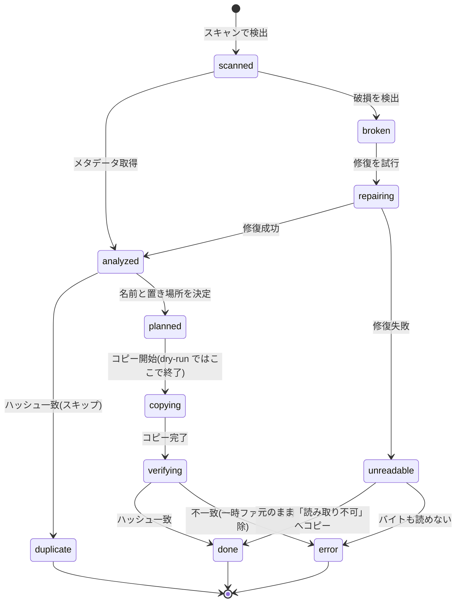

# 仕様書

要件(`docs/requirements.md`)を実現するための具体的な規則を定義する。
状態の凡例: **確定** = 合意済み / **仮** = 暫定案(`features/` の作成時に確認)。要件は、名前つきのリンクで併記する(要件定義の該当の行へ移る)。

## 1. 対応ファイル

### 1-1. 拡張子(仮)

判定は拡張子の大文字小文字を区別しない。出力時の拡張子は **小文字に統一**する。

| 種別                      | 拡張子                                                             |
| :------------------------ | :----------------------------------------------------------------- |
| 写真                      | jpg, jpeg, png, heic, heif, tif, tiff, gif, webp                   |
| RAW                       | cr2, cr3, nef, arw, dng, raf, orf, rw2, pef, srw, raw              |
| 動画                      | mp4, mov, m4v, avi, mts, m2ts, mkv, 3gp, wmv, m2t, webm, mpg, mpeg |
| サイドカー(読む / コピー) | `.xmp`(RAW と同名のものをコピー)、Takeout の `.json`(読むだけ)     |
| 対象外(件数のみ記録)      | `.aae`, `.thm`, `.lrv` などの上記以外のサイドカー                  |

拡張子は設定で追加できるようにする。拡張子が対象でも、中身が壊れていれば「破損」として扱う(§10)。

### 1-2. スキャン時に除外するもの

- ドライブの管理用ファイル・フォルダ: `._*`、`.DS_Store`、`Thumbs.db`、`.Trashes`、`.Spotlight-V100`、`.fseventsd`、`$RECYCLE.BIN`、`System Volume Information`
  - `._*` は、macOS が FAT32・exFAT のドライブに、書いたファイルごとに作る付属ファイル(AppleDouble)。写真と同じ拡張子(`._DSC_0001.jpg` など)のため、除外しないと、日付の取れない写真として数えてしまう(実データで確認)
- ライブラリの根(出力先)と、作業用の `data/`。出力先を再スキャンして二重に取り込まないため
- macOS の写真アプリのライブラリ(`*.photoslibrary`)。中身が管理用の構造で、ソースとして取り込む対象ではないため(仮)
- サイズが 0 バイトのファイル(エラー一覧に「空ファイル」として記録)

## 2. ライブラリと出力先

### 2-1. ライブラリの構成 (要件: [出力先はライブラリ](requirements.md#c-05)、[ライブラリの目印ファイル](requirements.md#m-05)、[相対パスで記録](requirements.md#m-06))

```text
<保存先ドライブ>/                       ← exFAT など(出力先のドライブの形式)
├── Pictures/                          ← ライブラリの根
│   ├── .file-seiri-library.json       ← 目印(ライブラリ ID、作成日、スキーマ版)
│   ├── 2024/
│   │   ├── 05/
│   │   │   ├── _時刻不明/             ← 年月日のみ取れたもの
│   │   │   │   └── 2024.05.01_IMG_0001.jpg
│   │   │   ├── _日付不明/             ← 年月のみ取れたもの
│   │   │   │   └── 2024.05_IMG_0002.jpg
│   │   │   ├── 2024.05.01_12-30-45_IMG_0004.jpg
│   │   │   ├── 2024.05.01_12-30-45_IMG_0004.cr3   ← RAW+JPEG は同名で並べる
│   │   │   ├── 2024.05.01_12-30-45_IMG_0004.xmp
│   │   │   └── 2024.05.01_12-30-46_MOV_0005.mp4
│   │   └── _月日不明/                 ← 年のみ取れたもの
│   │       └── 2024_IMG_0003.jpg
│   ├── _unknown/
│   │   ├── 日付なし/
│   │   ├── 日付が不正/
│   │   ├── 修復後も日付なし/
│   │   └── 読み取り不可/
│   └── .file-seiri/
│       ├── catalog.snapshot.sqlite    ← 台帳のコピー(§8)
│       └── thumbs/                    ← サムネイル(§16)
└── viewer/                            ← 閲覧用プログラム(OS ごと。§16-4)
```

- 写真・動画・RAW は、同じ階層に混在させる ([年月のフォルダに混在](requirements.md#t-06))。
- フォルダ名の先頭の `_` は、並び順で先頭に来るようにするため。
- ファイル名・フォルダ名は、**Unicode の NFC 形式**で保存する。(仮: macOS と Windows の間で、同じ名前が別物として扱われるのを避けるため)

### 2-2. ファイル名と置き場所 (要件: [ファイル名の形式](requirements.md#i-03)、[日付が一部だけのとき](requirements.md#i-07)、[日付の精度ごとの置き場所](requirements.md#u-01))

日付の精度(§3-3)によって、置き場所と名前が決まる。

| 日付の精度           | 置き場所(ライブラリの根から) | ファイル名                     |
| :------------------- | :--------------------------- | :----------------------------- |
| 年月日+時刻          | `YYYY/MM/`                   | `YYYY.MM.DD_HH-MM-SS_<元の名前>.<拡張子>` |
| 年月日のみ           | `YYYY/MM/_時刻不明/`         | `YYYY.MM.DD_<元の名前>.<拡張子>` |
| 年月のみ             | `YYYY/MM/_日付不明/`         | `YYYY.MM_<元の名前>.<拡張子>`  |
| 年のみ               | `YYYY/_月日不明/`            | `YYYY_<元の名前>.<拡張子>`     |
| 日付なし             | `_unknown/日付なし/`         | `<元の名前>.<拡張子>`          |
| 日付が不正           | `_unknown/日付が不正/`       | `<元の名前>.<拡張子>`          |
| 修復後も日付なし     | `_unknown/修復後も日付なし/` | `<元の名前>.<拡張子>`          |
| 読み取り・修復が不可 | `_unknown/読み取り不可/`     | `<元の名前>.<拡張子>`          |

- 名前の形は、すべての精度で、`<日付の部分>_<元の名前>.<拡張子>` にそろえる(日付が取れなかったものは、日付の部分がなく、元の名前だけ)。元の名前を付けることで、元の名前で探せ、同じ秒の写真(連写)も、名前で区別できる。
- 「元の名前」は、拡張子を除いたファイル名。ZIP 内のものは、ZIP 内でのファイル名。次のように整える。
  - 使えない文字(`/` `\` `:` `*` `?` `"` `<` `>` `|` と、制御文字)は、`_` に置き換える(Windows で使えないため)。
  - 先頭・末尾の空白とピリオドは、取り除く(Windows で使えないため)。
  - 長さは、60 文字(Unicode の文字数。NFC にしたあと)までにし、超えたら、先頭の 60 文字に切る(パスの長さの制限に、余裕を持たせるため)。
  - 空になったときは、`unnamed` にする。
  - 日付の部分が付かない名前(`_unknown/` の中)が、Windows の予約名(`CON`、`PRN`、`AUX`、`NUL`、`COM1`〜`COM9`、`LPT1`〜`LPT9`)と同じになるときは、先頭に `_` を付ける(拡張子がついても、Windows では、デバイスの名前として扱われるため)。
  - 整えた結果、同じ名前になったときは、連番で区別する。
- 連番: 衝突がなければ付けない。衝突したら、名前の最後(拡張子の前)に `_01`、`_02` … を付ける(2桁、100 以上は `_100` と桁を増やす)([同名の連番](requirements.md#i-04))。
  - 例: `2024.05.01_IMG_0001.jpg` が既にあれば、`2024.05.01_IMG_0001_01.jpg`。
  - 元の名前が付くため、衝突は、同じ日時・同じ元の名前の、内容の違うファイルに限られ、ほとんど起きない。
- 日時はローカル時刻(§3-2)。ミリ秒は名前に含めない。

### 2-3. 同名グループ (要件: [RAW と JPEG のペア](requirements.md#i-05))

同じソースフォルダにある、元の名前の語幹(拡張子を除いた部分)が同じファイルは **1つのグループ**として扱い、出力名の語幹(日付の部分 + 元の名前 + 連番)と置き場所を共有する。

- 例: `IMG_0001.CR3` / `IMG_0001.JPG` / `IMG_0001.xmp` → 全員 `2024.05.01_12-30-45_IMG_0001` + 各拡張子
- iPhone のライブフォト(`IMG_0001.HEIC` + `IMG_0001.MOV`)も同じ扱いとする(確定)
- 実データで見つかった `IMG_1234-video-paired.mov` のように、語幹に決まった接尾辞(既定: `-video-paired`)が付いた動画は、接尾辞を除いた語幹(`IMG_1234`)のグループに入れる。接尾辞の一覧は、設定で追加できる。(仮)
- グループの語幹の比較は、大文字小文字を区別しない(`IMG_1234.JPG` と `img_1234.CR3` は同じグループ)。拡張子まで同じ(大文字小文字を除く)ファイルが、同じ語幹にあるとき(大文字小文字を区別するドライブの `IMG_1234.JPG` と `img_1234.jpg` など)は、出力名が同じになるため、別のグループに分ける(名前順で、2 つ目以降を別のグループにする)。出力名に使う元の語幹は、グループの代表(日付を決めたファイル。同じ精度なら、名前順で先頭)のものを、全員で共有する。
- 日時の決定はグループ内の最も確かな取得元で1回だけ行う(例: RAW の EXIF を使い、JPG にも同じ日時を当てる)。「確かさ」は、EXIF・動画 > Takeout の json > ファイル名 の順。同じなら、精度(`full` > `date` > `month` > `year`)の高いもの、それでも同じなら、名前順で先頭のファイル。そのファイルの元の語幹を、グループの全員の出力名に使う(詳細は `features/date-resolution.md` §8)
- `.xmp` は、同じグループに RAW があるときだけ、グループの仲間にして、隣にコピーする。RAW のない `.xmp` は、コピーしない(対象外として、件数だけ記録する)
- 連番は「グループの全ての拡張子が空いている最初の語幹」を選ぶ。1つでも埋まっていれば次の連番に進む

### 2-4. 衝突判定

次のいずれかに同じ名前があれば衝突とする。

1. 出力先のフォルダに実在するファイル
2. 今回の実行で既に予約済みの名前(並列処理中の取り合いを防ぐため)

衝突時、内容が同じ(ハッシュ一致)なら重複としてスキップし、違えば連番で追加コピーする(§5)。

## 3. 日付の決定 (要件: [日付の決定](requirements.md#d-01))

### 3-1. 優先順位(確定)

| 優先 | 取得元                                                                                                                                      | 区分                                                   |
| :--- | :------------------------------------------------------------------------------------------------------------------------------------------ | :----------------------------------------------------- |
| 1    | EXIF の DateTimeOriginal(写真・RAW)                                                                                                         | 通常                                                   |
| 2    | 動画の CreateDate(UTC をローカル時刻へ変換)                                                                                                 | 通常                                                   |
| 3    | Takeout の `.json` の撮影日時                                                                                                               | フォールバック(`json`)                                 |
| 4    | ファイル名に含まれる日付(`IMG_20240501_123456`、`20240501`、`2024-05`、13 桁のエポックミリ秒など。詳細は `features/date-resolution.md` 4章) | フォールバック(`filename`)                             |
| —    | ファイルの更新日(mtime)                                                                                                                     | **日付として採用しない**。参考情報として DB に記録する |

- 優先順位1・2で取れなかった時点で「日付フォールバック」とし、取得元の種別と理由を記録する ([日付フォールバックの記録](requirements.md#d-03))。
- 優先順位1の中で DateTimeOriginal がなければ、DateTimeDigitized、CreateDate の順で試す(いずれも本体のメタデータなので通常扱い)。(仮)
- 1〜4のどれでも日付が取れなかった場合(mtime しかない場合を含む)は「日付なし」とする ([日付の代替の取得元](requirements.md#d-02))。

### 3-2. タイムゾーン(仮)

- 写真: EXIF にオフセット(OffsetTimeOriginal)があれば、その撮影地の時刻をそのまま使う。なければ書かれている値を、そのままローカル時刻として扱う。
- 動画: UTC で記録されていることが多いので、**本機のタイムゾーンへ変換**する。
- 全ての日時を、決定した値と、決定に使った取得元の種別とあわせて記録する。

### 3-3. 日付の精度

取得した値から、次の精度を判定する。

| 精度      | 条件                                                                         |
| :-------- | :--------------------------------------------------------------------------- |
| `full`    | 年・月・日・時刻がすべて有効                                                 |
| `date`    | 年・月・日が有効で、時刻がない                                               |
| `month`   | 年・月だけ有効                                                               |
| `year`    | 年だけ有効                                                                   |
| `none`    | どの取得元からも取れない                                                     |
| `invalid` | 値はあるが無効(`0000:00:00 00:00:00`、13月、1970 年より前、実行時点より未来) |

- 日付の一部が欠けている場合は、有効な範囲までを採用する。
- 無効な値は、次の優先順位の取得元に進む。すべて無効なら `invalid`、何もなければ `none`。

## 4. 取り込みの処理順

### 4-1. 実行全体

1. **準備**: ライブラリの確認、ソースの確認、容量チェック(§9)
2. **スキャン**: 対象を検出し、サイズ・mtime を記録
3. **ファイルごとの処理**(§4-2)
4. **後処理**: 台帳のスナップショットをライブラリに保存、サマリーを表示

### 4-2. 1ファイルあたり

1. **解析**: メタデータ(日時・GPS・カメラ・解像度)を取得。壊れていれば §10 へ
2. **ハッシュ計算**: キャッシュにあれば再利用(§6)
3. **重複判定**: カタログのハッシュと照合(§5)
4. **名前と置き場所の決定**: §2 に従って決める
5. **コピー**: 一時ファイルに書き、検証後に正式名にする(§7)。サムネイルは、コピーを終えたあと、実行の最後にまとめて作る(§16-2)
6. **記録**: 結果を DB に記録

### 4-3. ファイルの状態遷移



## 5. 重複 (要件: [重複](requirements.md#p-01))

- 判定: 内容のハッシュが完全に一致すること。名前・日時・サイズが同じだけでは重複にしない。
- 比較の対象: **カタログ全体**(過去の実行も含む)。同じライブラリの台帳の範囲に限る ([ライブラリごとに台帳が独立](requirements.md#m-09))。
- 重複と判定したら、コピーせずスキップし、「採用側のファイル」と「スキップ側のファイル」の対応を記録する。
- 同一実行内でも、先に処理された方を採用側とする。並列時は、ハッシュごとに最初に確定した1件を採用する。(仮)
- 「別物」判定(重複を別のファイルとして追加コピーする操作)は、今回は作らない(スコープ外)。重複は、Web の比較画面で、採用とスキップを確認するだけとする。
- 出力先にすでにあるファイルの登録(`index`)は、今回のスコープ外 ([既存の写真の登録(index)はスコープ外](requirements.md#m-10))。保存先は空のドライブから始める。

## 6. ハッシュとキャッシュ (要件: [ハッシュ・整合性](requirements.md#h-01))

- アルゴリズムは **SHA-256** とする(技術選定で決定。標準のコマンドで、独立して検証できるため)。以降は「ハッシュ」と表記する。
- キャッシュのキー: **(ボリューム識別子, ボリューム内の相対パス, サイズ, mtime[ミリ秒の整数])**
  - 外付けは、接続するたびにマウントパスが変わりうるため、パスだけをキーにしない。
  - サイズか mtime が変わっていたら、キャッシュを無効として再計算する。
  - mtime は、小数のミリ秒を**切り捨て**た整数にする。保存するときも、照合するときも、同じ丸め方にする(`er.md` §3-7)。
- 再計算の指示(`--rehash`)で、キャッシュを無視して全て計算し直せる ([キャッシュを使わない再計算](requirements.md#h-03))。
- コピー時は、読みながらソースのハッシュを計算し(1回の読み出しで済ませる)、書き終えたあとに出力先を読み直してハッシュを計算し、両者を比較する。
- **`verify`**: ライブラリの全ファイルのハッシュを計算し直して、台帳と照合する ([ライブラリ全体の再照合(verify)](requirements.md#h-06))。差異は、エラー一覧に記録する。ライブラリを別のドライブへコピーしたあとの確認に使う。

## 7. コピーと整合性 (要件: [上書きしない](requirements.md#i-06)、[更新日を引き継がない](requirements.md#i-08)、[コピー後のハッシュ照合](requirements.md#h-01)、[照合失敗の記録](requirements.md#h-04))

1. 出力先と同じフォルダに一時ファイル(`.<名前>.part`)を作って書く。**書き込みの時点から**、OS のキャッシュを使わない指定(macOS の `F_NOCACHE`)を付ける
2. **OS のキャッシュを経由せずに**出力先を読み直してハッシュを計算し、ソースのハッシュと比較する(書き込み直後の読み出しが、ディスクではなくメモリから返るのを避け、本当の破損を検出するため)。読むときにだけ `F_NOCACHE` を付けても、すでにキャッシュに載っているデータは、キャッシュから返るため、書き込みの時点から付ける(PoC で確認。[技術選定 §10-5](tech-selection.md))
3. 一致したら、**既存ファイルを上書きしない方法**で正式名へ名前を変更する(同名が既にあれば失敗させ、連番を取り直す)。macOS の `renamex_np`(`RENAME_EXCL`)を使う。exFAT では、同名があれば `EEXIST` で失敗し、同名がなければ「非対応」を返す(実測)ため、「非対応」のときは、存在確認のあとで、通常の名前の変更にする(書き込みは、ロックで 1 つの実行に限るため、確認と変更の間に、割り込まれない)
4. 正式名にしたあと、保存先が exFAT・FAT32 のときは、macOS が作る付属ファイル(`._名前`)を削除する。macOS は、書いたファイルに拡張属性(`com.apple.provenance`)を付け、これらのドライブでは、`._名前` として保存する。放っておくと、Windows から見たとき、ファイルが 2 倍に見える。付属ファイルを消しても、本体は無事で、作り直されない(PoC で確認)。付属ファイルは、コピーしたファイルだけでなく、**作ったフォルダ・目印・スナップショットにも**作られる(本実装の実機で確認)ため、本実行の最後(スナップショットの保存のあと)に、保存先全体を掃除する(本体が同じフォルダにある `._X` だけを、一覧を作って、1 つずつ消し、消えたことを確かめる)
5. 不一致なら、一時ファイルを削除し、エラーとして記録する(ソースは触らない)
6. 実行が中断されて残った一時ファイルは、次回起動時に削除する。削除は、先にフォルダの一覧を作ってから、1 つずつ消し、消えたことを確かめる(exFAT のドライブでは、再帰の削除が、最初の 1 ファイルだけで、エラーなしに止まることがある。PoC で確認)
7. コピーしたファイルの mtime は、**引き継がない**(コピーした時刻のままにする) ([更新日を引き継がない](requirements.md#i-08))

## 8. 台帳(カタログ)とログの保存場所

### 8-1. 作業用の置き場所 (要件: [作業用の台帳の置き場所](requirements.md#m-07))

```text
<プロジェクト>/data/                   ← .gitignore の対象
└── libraries/
    └── <ライブラリID>/
        ├── catalog.sqlite             ← 作業用の台帳(ハッシュキャッシュを含む)
        ├── thumbs/                    ← サムネイルの正本(§16-2)
        ├── logs/                      ← 実行ごとのログ
        ├── repaired/                  ← 修復で作った別ファイル(§10)
        └── tmp/                       ← ZIP の一時展開先
```

- 保存場所(`data/`)は、環境変数または設定ファイルで変更できる。
- 個人情報(パス・GPS・撮影日時)が入るため、git にコミットしてはならない。
- 作業用の台帳を外付けではなくこの Mac に置くのは、外付け HDD の細かい読み書きの遅さと、接続が途切れたときの破損を避けるため。

### 8-2. スナップショット (要件: [スナップショットの保存](requirements.md#m-08))

- 実行の最後に、台帳のコピーを `<ライブラリの根>/.file-seiri/catalog.snapshot.sqlite` に保存し、**サムネイルも、差分だけ、`.file-seiri/thumbs/` にコピーする**(家の PC で、ドライブをつなぐだけで見られるようにするため)。
- スナップショットは、`VACUUM INTO` で作る。**WAL ではない形式**で保存する(WAL のファイルは、読み取り専用のフォルダやドライブでは開けないため)。一時ファイルに作ってから名前を付け替え、`locks` は空にする。
- 台帳には、実行のたびに増える**リビジョン番号**を持たせる。
- 起動時に、ライブラリのスナップショットのリビジョンが作業用の台帳より新しい場合は、自動で上書きせず、利用者に確認する(この Mac の `data/` を失った場合は、スナップショットから復元できる)。置き換えるときも、前の台帳は消さずに、別名で残す。

### 8-3. 複数ソース (要件: [ソースごとの実行](requirements.md#m-01)〜[再実行で二重コピーしない](requirements.md#m-04))

- 実行(run)ごとに ID を付け、ソース(ボリューム)・開始/終了時刻・件数を記録する。
- 台帳はライブラリごとに1つで、実行を重ねるごとに累積する。過去の記録を消したり、上書きしたりしない。
- 同じソースを再実行したときは、「ソースのボリューム+相対パス+サイズ+mtime」が処理済みのものをスキップする。(仮)
- **中断と再開**:
  - Ctrl-C を 1 回押すと、今のファイルの処理を終えて、実行を `interrupted` にして終わる(終了コード 130)。続けて 2 回押すと、強制終了する。ドライブが抜けた・保存先の容量がなくなったときも、`interrupted` で止まる(終了コード 2)。
  - `ingest --resume` は、中断した実行(`interrupted` または `running`)の ID を引き継ぎ、状態を `running` に戻して、終わっていないファイル(`done` と `duplicate` 以外)だけを続ける。`--resume` がなければ、新しい実行として始め、処理済みのファイルは、二重にコピーしない(中断した実行があれば、注意を表示する)。
  - **コピーは、ファイルが先で、台帳が後**。コピーの前に、`COPY_START`(保存先・ハッシュ・語幹・区分)をイベントに記録する。異常終了で、保存先にファイルができたのに、台帳に記録されなかったものは、次の本実行の起動時に、「`COPY_START` があって `library_files` にない」ものとして見つけ、保存先のサイズとハッシュが一致すれば、採用する(別名 `_01` で重ねてコピーしない)。一致しなければ、触らない。
- **実行前の確認**: 計画の結果(ソース → 保存先、件数、容量)を見せたあと、端末では、「この内容で、コピーを始めますか」と確認する(`--yes` で省く)。端末でなければ、確認せずに進む。「いいえ」は、`interrupted` で終わり、`--resume` で続けられる。

### 8-4. ライブラリの移行

- ライブラリの根のフォルダごと、別のドライブへコピーする(OS の操作でも、コマンドでも良い)。
- 台帳は相対パスなので、書き換えは不要。コピー後に `verify` で照合する。
- この Mac は、目印ファイルのライブラリ ID で同じライブラリだと認識し、新しい場所を設定に記録する。

## 9. ドライブの選択と容量チェック (要件: [ドライブの選択と容量](requirements.md#v-01))

### 9-1. ドライブ一覧と選択

- `drives` コマンドで、接続中のドライブの名前・容量・空き・形式・種類(USB / 内蔵、HDD / SSD)を表示する。
- 取り込みの開始時、ソースと保存先を一覧から選べる(引数で指定しても良い)。
- ドライブは、名前ではなく**ボリュームの固有 ID**で識別する(同名の USB メモリが複数あっても取り違えない)。
- 保存先とソースが同じドライブなら、実行を止める。
- ソースが複数の場合は、**1つずつ順番に**処理する(同じハブの USB の帯域を奪い合わないため)。

### 9-2. 保存先の検査 (要件: [出力先のドライブの形式](requirements.md#c-09)、[保存先の書き込み・形式チェック](requirements.md#v-05))

次の場合は、理由を表示して実行を止める。

- 読み取り専用でマウントされている(NTFS を Mac で開いている場合など)
- 形式が NTFS(Mac から書けない)
- 形式が FAT32 で、コピー予定に 4GB 以上のファイルがある
- ライブラリの目印がない場合は、`library init <パス>` で作るか確認する

### 9-3. 容量チェック (要件: [容量チェック](requirements.md#v-04))

- 必要量 = コピー予定のファイルの合計サイズ(重複スキップ分は除く) + 余裕分。余裕分は、`max(5%, 10GB)`。(仮)
- 保存先の空きが必要量を下回る場合は、不足分を表示して、実行を止める。
- 作業用の領域(`data/`)の空きも確認する。必要量は、ZIP 内の最大の1ファイル分+修復用の領域。
- dry-run でも、同じ見積りを表示する。

## 10. ZIP・破損・修復

### 10-1. ZIP (要件: [ZIP 内のファイル](requirements.md#t-03)、[ZIP の入れ子](requirements.md#t-04))

- ZIP 内の**1ファイルずつ**を `tmp/` に取り出して処理し、完了したらすぐ消す。ZIP 全体を展開しない。必要な空きは、ZIP 内の最大の1ファイル分。
- 元の ZIP は変更しない。利用者が先に展開する必要はない。
- ZIP 内のフォルダは、何層でもたどる。
- ZIP の中の ZIP(入れ子)は深さ3まで開く。4段目以降は開かず、警告として記録する。
- 展開時はパスを検証し、展開先の外に出るパス(`../` など)は無視してエラーに記録する。
- ZIP 内のファイル名が cp932(Shift_JIS)の場合は文字化けを防ぐため、自動判定して変換する。
- 暗号化されているもの・壊れていて読めないものは、エラーに記録する。
- 1ファイルの展開サイズが異常に大きい場合に備え、上限(設定可能)を設ける。(仮)
- 記録上の「元の場所」は `ソース/path/to/a.zip!/inner/b.jpg` の形で表す。
- Takeout の `.json` は、写真と同じフォルダにある対応ファイルとして読む。
- **実装(`packages/cli/src/archive/`)**: ZIP は、自前の読み手で扱う(中央ディレクトリ・ZIP64・局所ヘッダの救出。保存と Deflate に対応。暗号化・ほかの圧縮は、開かない)。スキャンのあとに、ZIP の一覧だけを読んで、中のファイルを、ZIP の直後に足す。**取り出しは、解析のとき・コピーのときに、1 ファイルずつ**(ハッシュの計算と、コピーの、2 回。どちらも、終わったらすぐ消す)。取り出した一時ファイルの更新日は、ZIP に記録された日にそろえる。一時領域は `data/libraries/<ID>/tmp/`(`zip-<PID>-<連番>.part`。前の実行の残りは、次の実行の最初に消す)。
- **名前の文字コード**: UTF-8 の印(ビット 11、Unicode のパス)があれば UTF-8。印がなく、ASCII 以外を含むときは、UTF-8 として正しく読めれば UTF-8、読めなければ cp932(曖昧なものは、UTF-8 を採る)。NFC にそろえる。
- **安全対策**: `../`・絶対パス・ドライブ名・NUL を含むエントリは、展開せず、`ZIP_UNSAFE_PATH`。暗号化のエントリは `ZIP_ENCRYPTED`。展開サイズの上限は、1 エントリ 32 GiB(宣言のサイズと、実際に展開したバイト数の、両方を見る。超えたら止める)。CRC-32 とサイズを、取り出すたびに確かめる。壊れた ZIP は、読めたところまで処理し、`READ_FAILED` を記録する。
- **元の場所**: 台帳の `source_files.rel_path` は `DCIM/photos.zip!/trip/a.jpg`(入れ子は `a.zip!/b.zip!/c.jpg`)。同名グループ・Takeout の json の対応は、ZIP の中のフォルダごと。

### 10-2. 破損の検出 (要件: [破損の検出](requirements.md#r-01))

- 画像は、デコードを試みて途中で失敗するかを調べる。動画は、メタデータとストリームの読み取りが最後まで通るかを調べる。
- 「メタデータは読めるが、デコードは途中で失敗する」ものも破損として扱う。
- **メタデータが読めないこと(ExifTool が読めない)だけでは、破損としない**。日付などの情報が取れないだけで、写真・動画として開けるかもしれないため。日付は、ファイル名・Takeout の json で決め、普通に取り込む(取れなければ `_unknown/日付なし/`)。読めなかったことは、WARN のイベント(`META_UNREADABLE`)に残す。破損の判定は、上の検査(デコード・ストリーム・プレビュー)の結果で行う。

### 10-3. 修復 (要件: [自動修復](requirements.md#r-02)〜[修復の 3 つの手順](requirements.md#r-04))

- 元ファイルは変更せず、`repaired/` に別ファイルとして作る。
- 試す順序(仮): 動画の再構築 → メタデータの再書込み → 切れた画像の救出
- 修復後のファイルは、通常の取り込みと同じ流れ(§4-2)で処理する。記録には「修復済み」の印を付ける。
- 修復しても日付が取れなければ、`_unknown/修復後も日付なし/` に置く。
- 修復できなかったものは、元のバイトのまま `_unknown/読み取り不可/` にコピーし、試した手順と理由をエラー一覧に記録する(コードの使い分けは、§14) ([読み取れないファイル](requirements.md#i-09))。バイト自体が読めないものは、コピーできないので、エラー一覧にだけ記録する。
- 重複判定は修復後のハッシュで行う(修復で、元の内容と一致しなくなるため)。
- **実装(`packages/cli/src/repair/`、`ingest/analyze.ts`)**:
  - **疑う**: メタデータが読めない、または、ExifTool の警告があるファイルだけに、深い検査をかける(全ファイルにデコードをかけると、遅いため。取り込みの速さを、守る)。
  - **検査**(`ffmpeg -v error`。エラーが 1 行でも出たら、破損。切れた JPEG は、終了コード 0 のまま、`overread` を出すため): 画像はデコード(HEIC など ffmpeg で読めないものは `sips`)、動画は全ストリームを `-c copy` で最後まで、RAW は ExifTool のメタデータと埋め込みのプレビュー。ツールがなければ「検査できない」(破損とは、しない)。
  - **手順**: 動画 = 再構築(`ffmpeg -c copy`。再エンコードなし)→ メタデータの再書込み、画像 = メタデータの再書込み(全部消して、読める日付・GPS を写し直す)→ 切れた画像の救出(`ffmpeg -err_detect ignore_err`)、RAW = メタデータの再書込みだけ。各手順のあと、出力を再検査し、読めたらそこで終える。失敗した手順の出力は、消す。元より小さい救出は、「一部のみ救出」と詳細に記す。
  - **置き場所**: 修復で作る別ファイルは `data/libraries/<ID>/repaired/<source_file_id>-<元の名前>.<手順>.<拡張子>`(元のソースは、変えない)。修復できたら、そのファイルを、通常の流れで取り込み(修復後のハッシュ・日付・同名グループ)、`library_files.is_repaired` を立てる。修復後も日付がなければ `_unknown/修復後も日付なし/`。
  - **直せなかった**: 元のバイトのまま `_unknown/読み取り不可/<元の名前>`(衝突したら連番)。エラー一覧に `REPAIR_FAILED`(試した手順と理由つき)。**修復を試みなかった**(dry-run・道具が 1 つも使えない)ときは `CORRUPTED`。試した手順は `repair_attempts` に、スキップした手順は、エラーの詳細に残す。
  - 前の結果の再利用・`--retry-repair`(仮)は、作っていない(処理済みのファイルは、次の実行で、読み飛ばされるため、通常は、再修復にならない)。

## 11. dry-run (要件: [dry-run](requirements.md#x-01))

- §4-2 の 1〜4 までを実行し、コピー(5)と、作業用の領域以外への書き込みは行わない。
- 容量の見積り(§9-3)を表示する。
- 台帳には、通常の実行と区別できる印(`runs.is_dry_run`)を付けて記録し、Web で見られるようにする。通常の統計・地図・重複・アルバムの集計には含めない。
- dry-run の結果は、本実行のコピー結果と一致することを目指す(ただし、実行までの間に状況が変われば、変わりうる)。
- ハッシュ計算は既定で行う(重複判定に必要)。キャッシュがあれば速い。

## 12. 排他制御

- ファイルを書き込むのは **CLI だけ**。Web は、すべてのモードで読み取り専用 ([整理は CLI で行う](requirements.md#c-04)、[Web は閲覧専用](requirements.md#w-03))。
- 同じライブラリに、2つの実行(CLI)が同時に書き込まないよう、書き込みを **1つのロック**で直列化する。ロックは作業用の台帳(SQLite)の中に持ち、保持者・開始時刻・最終の生存通知(ハートビート)を記録する。
- ロックを持てるのは同時に1つの実行だけ。2つ目の実行は、保持者(pid・ホスト名・開始時刻・最後の生存通知)を表示して、**すぐ終了する**(待機しない。終了コードは、専用の値にする)。
- **保持者の文字列**: `pid@ホスト名#起動時刻#乱数`。乱数は、ロックを取るたびに 1 つ足す(同じ pid・ホスト名・起動時刻の、取り違えを防ぐ)。
- **ハートビート**: 10 秒おきに更新する。最後の更新から **60 秒以上**たったら、異常終了とみなす。この間隔と時間は、`ledger` の `LOCK_CONFIG` の 1 か所で決める。
- **途絶えたロックは、自動で引き継ぐ**。確認や取り替えは、1 つのトランザクションで行い、同時に 2 つが引き継ぐことはない。引き継いだ実行は、前の保持者を受け取り、前の実行を `interrupted` にして、WARN のイベントを残す。
- ロックの**更新と解放は、保持者の文字列が、自分のものと完全に一致するときだけ**行う。
- **ロックを失ったときの停止**: ハートビートを更新するたびに、保持者がまだ自分かを確かめる。違っていたら(スリープからの復帰などで、途絶と誤判定されて、別の実行に引き継がれたとき)、書き込みを止める。書き込みは、すべて、「保持者がまだ自分か」を確かめる、同じトランザクションの中で行う(確かめと書き込みの間に、別の実行が割り込めない)。
- 読み取り(Web での閲覧)は、ロックと無関係に常にできる。

## 13. ログ (要件: [ログ・進捗](requirements.md#l-01))

- 各処理を **イベント** として DB に記録する(実行・ファイル・種別・メッセージ・時刻)。CLI の表示も Web の実行状況も、このイベントから作る。
- 同じ内容をログファイル(`logs/`)にも書き出す。
- レベル: DEBUG / INFO / WARN / ERROR。

### 13-1. CLI の表示 ([CLI の逐次表示](requirements.md#l-01))

- 標準出力が端末のときだけ、ライブ表示(btop 風。[cli-logging](features/cli-logging.md) §4)を出す。端末でないとき(パイプ・リダイレクト)は、ログの行だけを出す(画面の制御文字を含めない)。
- 色は、`NO_COLOR` が設定されていれば使わない。24bit カラーの端末(`COLORTERM`)では 24bit カラー、それ以外は 16 色。
- 安全な停止は、`Ctrl-C` と `q`。画面を崩さずに終了し、終了コードは 130(詳細は cli-logging §8・§9)。
- 取り込み中は、`caffeinate -i` で、Mac のスリープを抑止する。取り込みのプロセスが終われば、自動で解除される。
- リポジトリの中では、mise が `bin/` を PATH に足すので、`seiri <コマンド>`(別名 `file-seiri`)とだけ打てる(外へ出ると使えない。`mise.toml` の `[env]`)。`bun run seiri <コマンド>` でも動く。
- **単一の実行ファイル**: `bun run build:binary` で `dist/seiri`(約 110MB。Bun の実行環境を含むので、Bun のない Mac でも動く)を作る。画面(静的書き出し)・地名データ(`cities.tsv`)・ExifTool(perl 版)を、埋め込む。ExifTool は、初回の実行で、キャッシュ(macOS: `~/Library/Caches/file-seiri/exiftool-<版>/`。`FILE_SEIRI_CACHE_DIR` で変えられる)へ展開し、2 回目からは、そのまま使う(展開は、途中で止まっても壊れないよう、別の名前で作ってから、置き換える)。この Mac に、perl(macOS に標準)が必要。`ffmpeg`・`sips` は、従来どおり、外のものを使う。実行ファイルの既定の `data/` は、`~/Library/Application Support/file-seiri`(開発のときの、リポジトリの `data/` とは、別。`--data-dir`・`FILE_SEIRI_DATA_DIR` で、同じものを指せる)。PATH の通った場所(例: `~/.local/bin`)へ、コピーすれば、どこからでも `seiri` と打てる。
- コマンド名は `seiri`(別名 `file-seiri`)。`seiri --help` で一覧と最初の流れ、`seiri <コマンド> --help`(または `seiri help <コマンド>`)で、意味・オプション・例を、やさしい日本語で表示する。`seiri --version` でバージョン。色は、端末で `NO_COLOR` がないときだけ。
- 対話式: 端末で `seiri` だけを打つと、入口のメニュー(取り込む・見る・状況・ドライブ・ヘルプ)が出る。`seiri ingest` で、取り込み元・`--dest` を省くと、足りない分を、番号で選べる(取り込み元: 外付けのドライブ・よく使う場所・フォルダをたどる・パス入力、複数可。保存先: 登録済みのライブラリ・新しく作る・パス指定。ZIP も、選べる)。最後に、「まず結果だけ(dry-run)/ 取り込む / やめる」を選び、同じことを自分で行うコマンドを表示する。選ぶ画面は、色つきの枠(ライブ表示と同じ配色)で、↑↓(j・k)で動かし、Enter で決め、q・Esc・Ctrl-C でやめる(PageUp・PageDown でまとめて動く。長い一覧は、見える範囲だけ出す)。決めた選択は、1 行の記録として残る。`TERM=dumb`・色なしの指定・端末でないときは、番号を入力する形になる。メニューで「見る」「状況」を選び、ライブラリが複数あるときは、どれか選べる。引数で指定する従来のやり方は、そのまま使える。端末でないときは、聞かずに、使い方のエラー。`q`・Ctrl-C で、中止(130)。パスの入力は、ドラッグで入る形(`\ `・引用符)と `~` を直す。
- 結果の表示(取り込みの結果・コピーの結果・状況・ドライブ・検査・ログ・ライブラリ作成・ビューア起動・できごとの計算)は、端末のとき、ライブ表示と同じ配色の、色つきの枠(見出し・札・区画・棒グラフ)で出す。失敗は、赤い札つき。端末でない・`NO_COLOR` のときは、文字だけの行(内容は同じ)。
- 取り込み元を複数指定したときは、1 つずつ別の実行として処理し、最後に、合計を出す。ほかの取り込み元の中にある取り込み元(と、同じ場所の重複)は、警告して外す。
- **ライブラリの選び方**(`--library` を省いたとき。status・logs・verify・thumbs・events・viewer・viewer-install): この Mac に登録されたものが 1 つならそれ。複数でも、ドライブが接続中のものが 1 つだけなら、それを自動で使う。接続中が複数なら、端末では一覧から選び、端末でなければ、一覧つきのエラー(`--library` で指定)。`seiri library list` で、登録済みの一覧(接続中かどうかつき)を見られる。同じ場所に作り直したときの**古い登録**(目印の ID が、登録と違うもの)は、選択肢に入れず、`library list` に「古い登録」と出す。`seiri library prune [-y]` で、設定から外せる(ファイルと、この Mac の台帳は、消さない)。`library init` は、同じ場所の前の登録を、外す。
- **結果の時間**: dry-run の結果に「所要時間」、本実行の結果に「解析の時間」、コピーの結果に「コピーの時間」と「平均の速さ」(読んだ量があり、0.1 秒以上かかったとき)を出す。
- **診断と片づけ**: `seiri doctor [--library] [--deep] [--fix] [-y]` は、登録(古い登録)・ドライブの目印(中身のないライブラリ=間違えて作った目印・この Mac に未登録のもの)・この Mac の台帳(整合 `PRAGMA quick_check`・ロックの途絶・実行中のまま止まった実行)・スナップショット(なし・古い)・中断で残った一時ファイル・付属ファイル(`._名前`)・ドライブの空き・登録のない作業用フォルダ・外のコマンド(perl・ffmpeg・sips)を調べ、見つけた問題と対処を出す。調べるだけでは、何も書き換えない。`--deep` は、台帳にある全ファイルの、存在・大きさ・サムネイルも調べる(中身の照合は、`verify`)。`--fix` は、安全に直せるもの(古い登録の削除・一時ファイル・付属ファイルの掃除)だけを、確認のうえ直す(写真・台帳は、消さない)。終了コード: 0 問題なし / 1 要対応あり。`seiri library forget <ID または場所>` は、設定から外すだけ。`seiri library remove <ID または場所> [-y]` は、**空のライブラリ**(間違えて作った目印)の、目印・管理用のフォルダ・登録・この Mac の空の台帳を消す(写真が 1 枚でもある・この Mac の台帳に記録が残っている場合は、断る)。
- **見張り**: `seiri status --watch [--interval <秒>]` は、実行中の取り込みを、別のウィンドウから見張る(進み具合・コピーの量・採用/重複/エラーの件数・経過時間・直近のログを、更新して出す。端末でなければ、変わったときだけ、1 行ずつ追記)。実行中のものがなければ、始まるまで待ち、見張っていた実行が終われば、自動で終わる。台帳は、読み取りだけで、毎回、開き直す。
- **取り込み後の抜き取り照合**: 本実行の最後(サムネイルのあと)に、この実行でコピーしたファイルの 2%(5〜100 件。少なければ全件)を、ライブラリから読み直し(OS のキャッシュを避ける)、台帳のハッシュと照合する(コピーのたびの照合とは別に、書き終えたあとの状態の確認)。違えば、`HASH_MISMATCH` のエラーとして記録し、終了コード 1。結果は、コピーの結果の下に出る。`--no-spot-check` で、行わない。全件の照合は、`seiri verify`。
- **バックアップ**: `seiri backup [--to <場所>] [--with-thumbs] [--list]` は、この Mac の設定(`config.json`)と、ライブラリごとの台帳(`VACUUM INTO`。取り込み中でも壊れない)を、`<場所>/backup-<UTC の日時>/` へコピーし、`manifest.json`(件数・リビジョン)を書く。既定の場所は `data/backups/`。ライブラリのドライブには、何も書かない。ドライブのスナップショットと、リビジョンを突き合わせ、「同じ / ドライブが新しい / この Mac が新しい / スナップショットなし / 未接続」を出す。復元は、中身を `data/` へコピーし直す。
- **取り込み元ごとの履歴**: `seiri sources` は、取り込み元(ドライブ)ごとに、取り込み回数・取り込み済みファイル数・最後の取り込み・dry-run の回数を出す。取り込みの結果にも、「このソースの履歴」(これまでの回数・ファイル数・最後の日付)を出す(2 回目以降)。
- **診断の報告**: `seiri doctor --report <ファイル>` は、診断の結果を、共有できる形で書き出す(`.json` なら JSON、それ以外は文章。seiri・bun・OS・外のコマンドの版つき)。既定では、パス・ファイル名(`detail`)を含めない。`--include-paths` で含める(ホームのパスは `~` に置き換える)。
- **解析中の速さ**: 取り込み中の画面は、解析の間も、ファイルを読んで計算した速さ(MB/s)と、1 秒あたりの件数(files/s)を出す。
- **ビューアの二重起動**: `seiri viewer` で、ポートが使用中のとき、同じライブラリのビューアが動いていれば(`/api/info` のライブラリ ID で判定)、起動せず、そのアドレスを出して、ブラウザで開く(終了コード 0)。別のライブラリのビューア・別のプログラムが使っているときは、`--port` の指定がなければ、空いているポートで起動する(その旨を表示)。`--port` の指定があれば、わかる言葉で止まる(終了コード 2。`--port 0` で、自動)。
- **数字のはみ出し**: 大きな数字(`.num`)は、1 行のまま、枠(カード)からはみ出す分だけ、縮める(`NumFit`。数え上がりや更新で文字が変わっても、測り直す)。枠に収まるものは、縮めない。
- **ブラウザの自動起動**: `seiri viewer` は、端末で動かすと、既定のブラウザで、アドレスを開く(`--no-open` で、開かない)。閲覧専用ビューア(Windows・Mac)は、いつも開く(`--no-open` で、開かない)。
- **テスト**: `bun run test` は、`--parallel` で、並列に動かす(約 8 秒。逐次は `bun run test:serial`、変更に関係するものだけは `bun run test:changed`)。端末の有無・色に左右されないよう、`test-setup.ts` で、環境をそろえる。
- 知らないコマンド・オプションには、近い名前を「もしかして: ingest」のように提案する(近い名前がなければ、出さない)。
- `--plain` を付けると、端末でも、ライブ表示を使わず、ログの行だけを出す。
- キーは、`p`(一時停止・再開。処理の合間で止まる)、`l`(ログの全画面)、`w`(Web)、`q`(安全に停止)。`Ctrl-C` は、1 回目が安全な停止、2 回目が強制終了(130)。
- ライブ表示の間は、標準出力の行を溜め、画面を閉じてから、まとめて出す(サマリーは、画面を閉じた後)。画面の高さが足りないときは、パネルを減らして出す。
- 表示の元データは、台帳のイベント(DEBUG を除く)と、取り込みから伝える進み具合。実測できない値は、出さない。

## 14. エラーの分類

| コード                    | 内容                             |
| :------------------------ | :------------------------------- |
| `READ_FAILED`             | 読み取りに失敗した               |
| `EMPTY_FILE`              | 空ファイル                       |
| `CORRUPTED`               | 破損を検出した(修復は行っていない) |
| `REPAIR_FAILED`           | 修復を試みたが失敗した(修復も不可) |
| `HASH_MISMATCH`           | コピー後のハッシュが一致しない   |
| `COPY_FAILED`             | 書き込みに失敗した(容量不足など) |
| `ZIP_DEPTH_EXCEEDED`      | ZIP の入れ子が深さ3を超えた      |
| `ZIP_DUPLICATE_ENTRY`     | ZIP の中に、同じ名前のファイルが複数ある(警告。連番を付けて、すべて取り込む) |
| `ZIP_UNSAFE_PATH`         | ZIP 内のパスが危険               |
| `ZIP_ENCRYPTED`           | 暗号化された ZIP                 |
| `METADATA_INVALID`        | メタデータが不正で読めない       |
| `DEST_NOT_WRITABLE`       | 保存先が書き込めない             |
| `DEST_FORMAT_UNSUPPORTED` | 保存先の形式が不適切             |
| `CAPACITY_SHORTAGE`       | 保存先の空きが足りない           |
| `VERIFY_MISMATCH`         | `verify` で台帳と一致しない      |

破損の記録は、そのときの状態の 1 つだけにする(1 つのファイルに、`CORRUPTED` と `REPAIR_FAILED` を重ねない)。

- 修復に成功したときは、エラーにしない(「修復済み」の印だけ)。
- 修復の手順を 1 つ以上試して、直らなかったときは、`REPAIR_FAILED`。
- 修復を試みなかったとき(dry-run、修復のツールが使えない、試行の上限を超えた)は、`CORRUPTED`。

## 15. GPS

- 緯度・経度を数値で保存する。(0, 0) は無効として扱い、「GPS なし」にする。
- 位置の推定は行わない ([GPS なしの一覧](requirements.md#g-04))。

## 16. アルバムとビューア(Web)

### 16-1. アルバムの構成 (要件: [入口は最新の年の机](requirements.md#a-01)〜[机の配置](requirements.md#a-03)、[マソンリーと行ぞろえ](requirements.md#a-05)〜[絞り込み](requirements.md#a-07))

- 入口は、**最新の年の机**。上に、「去年の今日」「今日の一枚」を置く ([入口は最新の年の机](requirements.md#a-01)、[去年の今日・今日の一枚](requirements.md#a-12))。
- ズーム(年 / 月 / できごと / すべて)と、**時間の定規**(年・月のつまみ)・パンくずで、行き来する ([年・月・できごと・すべてのズーム](requirements.md#a-02))。並び順の既定は、**新しい順**(古い順に切り替えられる)。
- ズームごとに、机に置くものを変える。

| ズーム   | 机に置くもの                                                           |
| :------- | :--------------------------------------------------------------------- |
| 年       | その年の、**月ごとの代表の 1 枚**(12 枚)                               |
| 月       | その月の、**できごとの束**(重ねたポラロイド)と、「ほか小さなできごと」 |
| できごと | そのできごとの**写真を広げる**(代表の枚数。「もっと広げる」で増やす)   |
| すべて   | **マソンリー**(既定)。**行ぞろえ**に切り替えられる                     |

- 「すべて」は、年月の区画(日付なし・月不明は最後)を縦に並べ、**画面に近い区画だけ**写真を読み込んで描く(仮想スクロール)。右の年の目盛りで、その年へ飛べる。配置は、URL の `layout` で持つ。
- 検索・絞り込みは、すべてのズームに効く ([検索](requirements.md#a-06)、[絞り込み](requirements.md#a-07))。
- 絞り込みの条件は、URL のクエリ(`kind`・`camera`・`gps`・`year`・`precision`・`source`・`volume`。同じ名前を繰り返せる)に持ち、年・月・できごと・すべての移動で引き継ぐ。引き出しの件数は、**その項目自身の条件を外して**数える(選んだあとも、ほかの選択肢の件数が見え、足して広げられる)。件数 0 の選択肢は、淡く出す。月のできごとは、条件に合う写真があるものだけを、合う枚数で出す。
- 検索: 日付・カメラ・場所・ファイル名。入力中の候補と、条件の札(チップ)。結果は、代表の枚数だけ机に広げ、全部は、「すべて」(一覧)へ。
  - 日付は「2014」「2014年4月」「2014-04-12」などの書き方を、そろえて前方一致で探す。名前は、ファイル名(ディレクトリは含めない)に含む文字で、大文字・小文字は区別しない。場所は、**地名**(市区町村・都道府県(日本)・国。日本語・英語で探せる)と、**GPS を 0.1 度(約 11km)の格子にまとめた座標**で探す。カメラは、機種名の一部。
  - **地名**(`area=city:<ID>`・`pref:<2 桁>`・`country:<国コード>`): 同梱の地名データ(GeoNames の都市一覧。日本は人口 5,000 以上、そのほかは 15,000 以上。約 3.5 万件)から、写真の GPS に近い地名を求める。**通信はしない**。日本は、近い範囲の市区町村(浅草の近くなら「浅草区」)、日本以外は、近い範囲で人口の多い地名(「パリ」)。80km より遠ければ、地名なし(座標の検索は、使える)。地名は、小さな町や、昔の区名のことがあるため、「付近」として示す。台帳の GPS の格子を地名で分類して、場所の条件にする。入力が空のときは、よく撮った地名・都道府県・国を、件数つきで出す。拡大表示の GPS の欄にも、地名を出す。データの作り方と出典は、`packages/core/src/geo/README.md`。
  - 同じ種類の条件は、どれか(OR)、違う種類の条件は、すべて(AND)。候補の件数は、いまの条件に、その候補を足した結果の枚数(0 件は出さない)。入力が空なら、よく撮った場所とカメラを出す。
  - 条件は、URL のクエリ(`date`・`name`・`place=緯度:経度`)に持つ。候補を選ぶと、検索結果の画面(`view=search`)へ移る。条件をすべて外すと、入口へ戻る。
- 絞り込み: 種別(写真・動画・RAW)、カメラ、GPS(あり・なし)、年、日付の精度(`full` / `date` / `month` / `year` / `none` / `invalid`)、日付の取得元(通常 / `json` / `filename`)、ソース。付箋のチップと、右の引き出し(チェックと件数)。
- **拡大表示**(`view=photo&p=<写真の ID>`): 机・すべて・検索結果・できごとの写真を押すと開く。前後の写真(← →)は、**開いた画面の絞り込みの条件と並び順**で決め(できごとから開いたときは、そのできごとの中だけ)、下に、前後 8 枚のフィルムストリップを出す。右の引き出し(`i` で開閉)に、撮影日時(取得元・精度)・カメラ・寸法・大きさ・種別・ハッシュ・パス・GPS・「もっと見る」(この場所の写真・同じできごと)。同名グループ(JPG・RAW・XMP)は、札で見るファイルを切り替える。閲覧専用。
- **スライドショー**(`view=slide`): 拡大表示・できごと・検索結果・すべて(絞り込み済み)から始める。開いた画面の条件・並び順の写真を、先頭から最大 3,000 枚、順に見せる。速度(2・3・5・8・10 秒。既定 3 秒)と順序(新しい順・古い順・シャッフル)は、URL(`speed`・`order`・`shuffle`)に持つ。Space で停止・再開、← → で前後、Esc で終了。進捗の棒と、次の 8 枚の縮小を出す。動画は、音を出さずに再生し、再生を終えてから次へ。最後まで見たら止まり、「もう一度」で最初から。
- **カレンダー**(アルバムとは別のページ `/calendar?y=<年>&d=<選んだ日>`。上のナビの、「アルバム」の右の「カレンダー」から)。絞り込み・検索の条件は、そのページの URL に持つ(ナビで行き来すると、条件は、リセットされる)。検索の候補を決めると、アルバムの検索結果へ移る。年を選ぶと、12 か月のマス(日曜はじまり)に、日ごとの枚数を、**5 段階の濃さ**(0 = 写真なし、1〜4 = その年でいちばん多い日を基準に 4 等分)で出す。マスを選ぶと、右に、その日のまとめ(枚数・撮影の最初と最後の時刻・GPS の枚数)と小さな写真 6 枚、「この日の写真を机に広げる」(検索結果の画面)・「スライドショー」。「この年で多かった日」の上位 3 件。日を選んでいなければ、いちばん多かった日。**日まで分かる写真だけ**が載る(年・月だけのもの、日付のないものは、載らない)。絞り込み・検索の条件が効く。
- **自動アルバム**(`/albums`。上のナビの「自動アルバム」): 自動でまとめた**できごと**(新しい順。最初に 8 件、「もっと見る」で増やす。代表の写真・枚数・時刻の幅・カメラ・GPS と動画の印)と、**いろいろな切り口**(少数に絞る): 動画・RAW・ライブフォト(同名グループに、写真と動画の両方がある。「組」で数える)・場所のある写真・カメラ別(多い機種から 2 つ)・日付フォールバック(日付の取得元が json・ファイル名)・日付なし(精度が none・invalid)。写真のない切り口は出さない。できごとは、その机へ、切り口は、その条件の「すべて」へ(条件は札になり、外せる。ライブフォトは、条件 `live=1`)。自分で作るアルバム・お気に入りは、ない。
- **状態の帯**(上のナビの下。`GET /api/info` の `libraryConnected`): ライブラリのドライブが外れているときは、**注意の帯**(オレンジ。「〇〇のドライブを接続してください(原本を開くため)」と「再確認」。外れている間は、10 秒ごとに自動で確かめる)。サムネイルの一覧は、外れていても、見られる(拡大表示は、サムネイルに切り替わる)。スナップショットを見ているとき(家の PC など)は、**情報の帯**(「最後の snapshot の内容です(日時)。新しい取り込みは、この Mac で行います。」)。
- **結果なし**: 条件に合う写真が 0 件のとき(アルバム・検索結果・すべて・カレンダー)は、「条件に合う写真は、0 件」と、「**条件を 1 つずつ外す**」(いちばん後ろの条件から。検索の条件→絞り込みの順)・「すべてクリア」を出す。
- **日付が不明なもの**(自動アルバムの下): 時刻不明(精度 date)・日不明(month)・月日不明(year)・日付なし(none・invalid)の枚数を、札で出す。押すと、その精度の「すべて」へ。カレンダーには載らない。
- **地図**(`/map`。上のナビの「地図」。MapLibre GL JS): GPS のある写真を、**まとまり**(件数の円。多いほど大きく、件数で色が変わる)と**ピン**(1 枚)で出す。まとまりは、**サーバーが、表示範囲とズームに応じて束ねる**(`GET /api/map/clusters?view=南,西,北,東&zoom=`。格子の大きさは、ズームが 1 上がるごとに半分。1 回に最大 2,000 件)。**4 枚までのまとまりは、円ではなく、ピン(オレンジのしずく形。2 枚以上が重なる場所は、枚数の印つき)**で出す。ピン・同じ位置(どこまで近づいても、1 つに束ねる)・これ以上近づけないまとまりを押すと、その場所の**ミニプレビュー**(写真を **1 枚ずつ**、大きめに。撮影日時・ファイル名・「拡大表示へ」)を出す。同じ場所に複数枚あるときは、← →(キーも)で 1 枚ずつめくり、下の小さな札の列から、その 1 枚へ飛べる。30 枚まで(それより多ければ「N 枚すべてを、アルバムで」)。ピン・プレビューのない所を押すか、Esc で、プレビューを閉じる(地図を動かすドラッグでは、閉じない)。5 枚以上の円は、押すと、その範囲へ拡大する。束ねる格子は、近づくほど細かい(ズーム 13 以上で 24px、15 以上で 14px。遠いときは 40px)。**場所の指定**: 地図の上の入力で、地名・都道府県・国(日本語・英語)を探して、決めると、地図がそこへ動く(写真のない場所へも動ける。`GET /api/map/places?q=`)。右に、**地図に見えている範囲**の件数と写真(9 枚。見えていない場所の写真は、含めない)、「アルバムで見る」(`bbox` 条件の「すべて」)。絞り込み・検索の条件は、アルバムと同じ(URL のクエリ)。位置と拡大は、URL(`c=緯度,経度`・`z=ズーム`)に持つ。GPS が(0, 0)のものは、無効として、除く。「GPS なし N → アルバムで見る」。位置の推定は、しない。
  - **背景地図**: オンラインの地図タイル。既定は、国土地理院の地理院タイル(環境変数 `FILE_SEIRI_MAP_TILES=osm` で、OpenStreetMap)。外へ送られるのは、タイルの要求だけ。出典を画面に出す。ネットに未接続なら、背景なしで、ピンと一覧だけ(後ろの格子が見える)。
  - 期間の指定(仮)は、まだ作っていない。
- **統計**(`/stats`。`GET /api/stats?monthsYear=`。台帳だけで計算するので、ドライブが外れていても見られる): 上に、総ファイル数・総サイズ・期間(最初と最後の撮影日)・GPS(地図へ)。**期間別の件数**は、月別(年を選ぶ。既定は、写真のある最新の年)と年別を切り替え、**種別の内訳つきの積み上げ棒**(写真・動画・RAW)。年月が取れていないものは、「不明」の棒にまとめる(月別は、その年の「年だけ」のもの。年別は、日付なし・不正)。合計は、全体の件数と合う。棒を押すと、その期間のアルバム(年・月)、「不明」の棒は、その精度の「すべて」へ。**カメラ別**(多い順に 8 機種まで。不明は最後)・**撮影時間帯**(0〜23 時。精度が `full` のものだけ。対象外の件数を注記)・日付の精度(押すと、その精度の「すべて」)・日付フォールバック(json・filename・none。「一覧へ」)・種別。種別の札(全種別・写真・動画・RAW)で絞り込める(すべてのグラフに効く。種別の件数だけは、種別の絞り込みを外して数える)。重複としてスキップしたファイルは、数えない(ライブラリにあるファイルを数える)。
- **原本の配信**(`GET /api/files/<ID>`): 台帳にあるファイルの、ライブラリの根の下だけを、そのまま返す(根の外は、台帳の値が壊れていても読ませない。動画は範囲指定に答える)。ブラウザが表示できる形(JPEG・PNG・GIF・WebP・AVIF・BMP・MP4・MOV・WebM)だけで、HEIC・RAW は、サムネイルを見せる。ドライブが接続されていなければ、サムネイルに切り替え、案内を出す。
- 対象は、通常の実行で取り込んだデータ(dry-run は含まない)。
- **お気に入り・マイアルバムは、ない**(書き込みを、持たないため)。

- **月の机の「できごとに入らない写真」**: できごとは、日まで分かる写真から作るため、日付が月までしか分からない写真は、束にならない。月の机の下に、できごとに入らない写真(先頭の 60 枚と、全部の枚数)と、「この月の写真を、すべて一覧で」(その月の検索)を出す。できごとが 1 つもない月でも、これで写真が見られる(`GET /api/album/month` の `loose`)。
- **地図の最大ズームと範囲の丸め**: ズーム 16 以上では、件数が多くても、円ではなく、ピン(件数の印つき)で出す(ここまで近づいて残るまとまりは、同じ場所の写真だけ)。範囲の文字(`bbox`・`view`)は、小数点以下 5 桁で、広がる向きに丸める(南・西は切り捨て、北・東は切り上げ)。四捨五入だと、1 点のまとまりの範囲が、その写真自身を含まなくなり、ミニプレビューが空になっていた。ミニプレビューの写真は、サムネイル → 原本(表示できる画像)→ ファイル名の札、の順に切り替える(サムネイルのファイルがなくても、空にならない)。
- **一覧と詳細の画面(重複比較・エラー一覧・実行履歴)**: 共通の部品(`SplitView`)。比較・詳細の部分は、画面に固定され(開いたとき、そこまで動く)、左の一覧だけがスクロールする。選んだものは、一覧の見える範囲に入る。詳細の上に、大きな「前の○○」「次の○○」(○○は、重複・エラー・実行。← → キー・j k キーでも。ページの端では、前後のページへ続く)と、「N / 全体 件目」を出す。
- **拡大表示の追加の項目**: 情報に、GPS の**ミニ地図**(動かせない小さな地図。押すと、地図の画面で、その場所を開く。ネットに未接続なら、出さない)と、**この日の他の年**(同じ月日の、ほかの年の写真。年ごとに、枚数と代表の 1 枚。押すと、その日の検索。`GET /api/album/photo/:id/same-day`。日まで分からない写真は、出さない)。
- **期間の指定**: 絞り込みの引き出しに、期間(開始〜終了。両端を含む。`from=YYYY-MM-DD`・`to=`)。日まで分かる写真だけが、対象。アルバム・地図・統計など、絞り込みのある画面すべてに効く。
- **統計のソースの絞り込み**: 統計の上に、種別と並べて、ソース(取り込み元のドライブ)の札(2 つ以上あるとき)。ドライブ単位で絞る(実行ごとではない)。
- **読み取り不可のファイル**(`_unknown/読み取り不可/`): サムネイルの代わりに、「!」と「壊れていて、読めませんでした」を出す(縞の背景)。

### 16-2. サムネイル (要件: [サムネイルの作成](requirements.md#a-14))

- **作る時期**: 実行の最後(コピーのあと、スナップショットの前)に、サムネイルのないライブラリのファイルへ、まとめて作る。コピー中のデータからは作らない(外のコマンド `sips`・ffmpeg が、ファイルのパスを取るため)。保存先のファイルを、もう一度読む。
- **形式・大きさ**: JPEG(品質 80)、長辺 400px、一覧用の 1 サイズ。元より大きくは、しない。macOS の `sips` と ffmpeg は、WebP を書き出せないため、JPEG にした。EXIF の向きは、タグのまま残る(表示側が従う)。
- **作り方**: 写真・HEIC は `sips`。RAW は、ExifTool で埋め込みのプレビューを取り出し、`sips` で縮小する。動画は、ffmpeg で、長さの 10% の位置の 1 コマ(取れなければ、最初の 1 コマ)。
- **名前**: 内容のハッシュ。`<ハッシュの先頭 2 文字>/<ハッシュ>.jpg`(`library_files.thumb_rel_path` に、この相対パスを持つ)。同じ内容は、サムネイルも 1 つ。
- **正本**: この Mac の `data/libraries/<ライブラリID>/thumbs/`。台帳(作業用)と同じ場所に置く。
- **コピー**: `<ライブラリの根>/.file-seiri/thumbs/`。実行の最後に、差分だけ(同じ名前・同じ大きさは飛ばす)、コピーする(§8-2)。家の PC は、こちらを使う。
- これにより、**この Mac では、外付けのドライブを外していても、一覧・統計・地図の画面が使える**。
- **作れなかったとき**: 取り込みは、失敗にしない。WARN のイベント(`THUMB_FAILED`)を残し、`thumb_rel_path` は空のままにする。破損の判定には、使わない。
- **`thumbs` コマンド**: `file-seiri thumbs [--library <パス>]`。サムネイルのない(記録がない、または、正本のファイルが消えた)ファイルにだけ作り、差分をコピーする。何度でも実行できる。止めても(Ctrl-C)、次の実行が、残りから続ける。実行(`runs.kind = 'thumbs'`)として記録し、リビジョンを +1 して、スナップショットを保存する。書き込みのロックを取る。終了コードは、作れなかったものがあれば 1。
- 対象は、写真・動画・RAW。サイドカー(XMP)には、作らない。

### 16-3. 画面の一覧

- アルバム: 入口 / 机(年・月・できごと)/ すべて(マソンリー・行ぞろえ)/ 検索・絞り込み / 拡大表示 / スライドショー / カレンダー / 自動アルバム / 状態
- そのほか: ダッシュボード、地図、統計、重複比較、日付フォールバック一覧、エラー一覧、実行状況(リアルタイム)、dry-run の結果

### 16-4. 閲覧専用ビューア (要件: [閲覧専用ビューア](requirements.md#w-01))

- OS ごとの単体の実行ファイル(macOS 用・Windows 用)を、ドライブの `viewer/` に置く。実行環境のインストールは要らない。
- 起動すると、ライブラリの `.file-seiri/` の台帳とサムネイルを**読み取り専用**で開き、ブラウザで表示する。
- 台帳のパスは相対パスなので、ドライブ文字・マウント先が変わっても動く。
- 書き込み・コピーを伴う操作は、持たない(Web は、すべてのモードで閲覧専用) ([Web は閲覧専用](requirements.md#w-03))。
- 技術選定では、この配布形態(OS ごとの単体の実行ファイル)を条件にする。

### 16-5. 背景地図 (要件: [オンラインの地図タイル](requirements.md#c-11)、[背景地図の表示](requirements.md#g-03))

- 地図の背景は、オンラインの地図タイルを取得して表示する。タイルの提供元は、設定で変更できる。
- 外部に送られるのは、「見ている範囲のタイルの要求」だけ。写真・台帳のデータは、送らない。
- ネットにつながらない場合は、背景を出さず、ピンと座標の一覧だけを使えるようにする。
- 地図の出典の表記(著作権表示)を、画面に出す。
- 地図のライブラリとタイルの提供元は、技術選定で決める。

### 16-6. できごと (要件: [できごとの自動まとめ](requirements.md#a-04))

アルバムの単位。取り込みの最後に、CLI が計算して、台帳(`album_events`)に保存する。Web は、読むだけ。

- 日付の精度が `full` / `date` のものを、撮影日時順に並べる。
- 隣り合う 2 枚を比べて、次のいずれかなら、**新しいできごと**を始める。(値は、既定。設定で変えられる)
  - 時間差が **4 時間以上**
  - 距離が **5km 以上**で、かつ時間差が **1 時間以上**(GPS がある場合のみ)
- 精度が `date` のもの(時刻なし)は、**日単位**でまとめる。
- 3 枚未満のできごとは、月の机に、「小さなできごと」としてまとめる。
- 精度が `month` / `year` / `none` / `invalid` のものは、できごとにしない(自動アルバムの「日付なし」などで見る)。
- **代表の写真**: GPS つきの写真を優先し、なければ、できごとの先頭の写真。(仮)
- 再計算は、取り込みのたびに、全体を、やり直す(台帳のリビジョンごと)。**本実行の終わりに、リビジョンを +1 するのと同じトランザクションで**行い、`ALBUM_EVENTS`(INFO)のイベントを残す。dry-run では、しない。
- `file-seiri events [--library <パス>]`: 計算し直す(できごとの計算ができる前に取り込んだライブラリや、規則を変えたあと用)。書き込みのロックを取り、リビジョンを +1 して、スナップショットを保存する。実行の記録は、作らない。
- 計算の実装は、`core` の `computeAlbumEvents`(純粋な計算)。保存は、`cli` の `rebuildAlbumEvents`。

### 16-7. 原本の探索 (要件: [原本の探索](requirements.md#a-15))

拡大表示・スライドショーで、原本を開くとき、**接続されている場所を、順に探す**。

1. ライブラリの `library_files`(接続中のドライブ、またはこの Mac)
2. 同じ内容(`content_id`)を持つ `source_files` のうち、**接続中のボリューム**にあるもの(例: 取り込み元だった、この Mac のフォルダ)
3. どちらもなければ、サムネイルを表示し、「〇〇のドライブを接続してください」と、必要なドライブ名(`volumes.label`)を案内する

- 2 は、サイズと更新日が、記録と一致する場合だけ使う(ハッシュは、再計算しない)。表示中は、「ソース側のコピーを表示中」と明示する。
- 実装: 同じ内容(`source_files.content_id`)で、ZIP の中でない、コピー済み・重複のソース側のファイルを候補にする。ドライブの固有 ID から、いま接続中の根を引き(ビューアを起動する側が渡す。10 秒、覚える)、根の外を指すパスは使わない。表示は `GET /api/files/:id` が、同じ経路でソース側から返す。`GET /api/album/photo/:id` の `original.from`(`library` / `source`)と `sourceLabel` で、画面が示す。どれも読めなければ、サムネイルと、「『ドライブ名』のドライブを、接続してください」。
- ソースは、手動で削除される場合があるので、必ず存在するとは、みなさない。見つからなければ、次へ進む。
- 家の PC では、ソースは接続されないので、1 だけを探す。

### 16-8. 机の配置規則 (要件: [机の配置](requirements.md#a-03))

- 机の中の写真は、**格子の上に、傾けて置く**。位置の数値は、決めうちにしない(重なりと、はみ出しを、防ぐため)。
- 格子は、4 列(検索結果の机は、3 列)。間隔は、約 44〜52px。傾きは、±3° 以内。
- 一番大きい 1 枚(年の机の最多の月、できごとの机の先頭、新しい年の最新の月)は、2 列 × 2 行の大きさにする。
- 写真の縦横の比率(4:3、3:4、1:1、3:2)を、順に、割り当てる。
- 並び順は、新しい順が既定。時間の定規で、反転できる。
- 机は、背景に点の柄、枠は黒の 3px、ぼかしのない影を使う([design.md](design.md))。

### 16-9. デザイン方針 (要件: [机の配置](requirements.md#a-03))

ネオブルータリズムに決定。色・文字・枠・影などの方針は、[design.md](design.md) が正本。

### 16-10. 去年の今日 / 今日の一枚 (要件: [去年の今日・今日の一枚](requirements.md#a-12))

- **去年の今日**: 今日と同じ月日の、過去の年の写真(できごと)。最大 3 件。なければ、帯を出さない。
- **今日の一枚**: 日付ごとに固定の乱数で選ぶ(同じ日は、同じ写真)。「別の 1 枚」で、選び直せる。対象は、写真(動画・RAW を除く)で、日付の精度が `full` のもの。

## 17. 性能の方針 (要件: [速く完走](requirements.md#n-01)、[性能の工夫](requirements.md#n-05))

1. ハッシュ計算とコピーを、1回の読み出しで同時に行う
2. 検証読み出しは、OS のキャッシュを経由しない。書き込みの時点から `F_NOCACHE` を付ける(§7)
3. HDD は並列を絞って順番に読み、SSD は並列にする。ドライブの種類で自動的に切り替える
4. メタデータの取得は、常駐するプロセスにまとめて渡す(ファイルごとに起動しない)
5. ハッシュキャッシュ(§6)
6. 台帳(SQLite)への書き込みを、まとめてコミットする
7. 同じ USB バスにつながったドライブは、同時に処理しない(§9-1)

### 17-1. 測定値(PoC。この Mac、USB の HDD・exFAT)

| 項目                                                 | 値                                                                     |
| :--------------------------------------------------- | :--------------------------------------------------------------------- |
| ディスクからの読み出し(`F_NOCACHE`)                  | 約 200 MB/s                                                            |
| ディスクへの書き込み(`F_NOCACHE`、大きな 1 ファイル) | 約 130〜150 MB/s                                                       |
| コピー + ハッシュ + `fsync` + 名前の変更(実ファイル) | 約 66〜69 MB/s(1 ファイル平均 6〜7MB。ファイル 1 つごとの手間が支配的) |
| 読み直しての検証(`F_NOCACHE`)                        | 約 86〜93 MB/s                                                         |
| 全体(コピー + 検証)                                  | 約 38 MB/s、約 6 ファイル/秒。約 124GB の全件で、約 55 分の見込み      |
| メタデータの取得(内蔵ディスク、ExifTool)             | 約 200 ファイル/秒(15,447 ファイル + ZIP 内 487 件を 75 秒)            |
| SHA-256 の計算だけ                                   | 約 3,300 MB/s(速度の足を引っ張らない)                                  |

- 読み書きの単位は、4MiB で十分(4〜64MiB で、差は出なかった)。
- 「約 60MB/s 以上」の目標は、コピーの段階で満たした。検証の読み直しを含めた全体は、約 38 MB/s。
- 複数ファイルを重ねて処理する並列は、未測定(必要になれば、実装のときに試す)。

## 18. 未決

詳細は、[open-items.md](open-items.md) を見る(未決・仮は、そこに集めている)。
